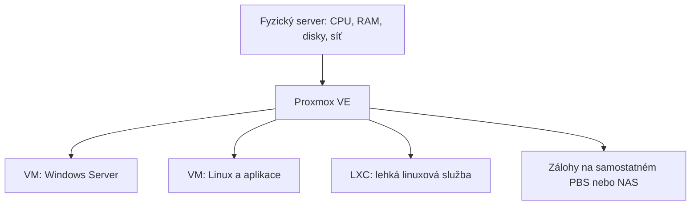

Here is the result of "fetch" for the Page with URL https://app.notion.com/p/403bceb1e413811cb04ef027bd9f8715 as of 2026-10-24T10:26:10.192Z:
<page url="https://app.notion.com/p/403bceb1e413811cb04ef027bd9f8715">
<ancestor-path>
<parent-page url="https://app.notion.com/p/403bceb1e413801d98a5dfd2c1d9d8b9" title="Student IT support"/>
</ancestor-path>
<properties>
{"title":"Proxmox — praktická příručka pro nasazení a správu serverů"}
</properties>
<iconMetadata>null</iconMetadata>
<content>
Ověřeno: <date start="2026-10-24" />. Oficiální web při ověření uvádí <b>Proxmox VE 9.2</b>. Před instalací stáhni aktuální stabilní ISO; názvy položek GUI se mezi verzemi mohou mírně lišit. [Aktuální verze a dokumentace](https://www.proxmox.com/en/downloads/proxmox-virtual-environment/documentation)

<table-of-contents />

# 1. K čemu Proxmox použiješ

<b>Proxmox VE (PVE)</b> nainstaluješ na fyzický server a z něj spravuješ více virtuálních serverů. Typicky vedle sebe poběží Windows Server, Linux, monitoring, testovací prostředí nebo interní aplikace. CPU, RAM, disky a síť fyzického stroje rozdělíš mezi hosty. Správa probíhá přes web, konzoli a API.

<b>Proxmox Backup Server (PBS)</b> je samostatná zálohovací služba. Slouží k ukládání a obnově záloh; nabízí deduplikaci, kompresi a šifrování. Pro první nasazení potřebuješ hlavně PVE, PBS řešíš jako cíl záloh. [Přehled produktů](https://www.proxmox.com/en/)



<b>Slovníček:</b> node = fyzický hostitel s PVE; guest = VM nebo kontejner; VMID = číselný identifikátor hosta; storage = úložiště; bridge = virtuální síťový přepínač; cluster = skupina uzlů pod společnou správou.

# 2. Jak bych začal na prvním serveru

<b>Modelový návrh, který uprav podle služeb a rozpočtu:</b>

- Jeden server, 32–64 GB RAM jako pohodlný začátek pro několik menších služeb.
- Dva vhodné SSD v ZFS mirroru, pokud řadič zpřístupňuje disky přímo.
- Pevná management IP, přístup ke vzdálené konzoli serveru a UPS.
- Jedna testovací Linux VM; následně první skutečná služba.
- Samostatný zálohovací cíl, automatické zálohy a zkouška obnovy.

Tohle není univerzální sizing. Sečti RAM potřebnou pro hosty, přidej rezervu hostitele a úložiště; kapacitu disků počítej podle reálného růstu dat, snapshotů a záloh. U clusteru přidej kapacitu pro provoz po výpadku uzlu.

<b>Pokud máš jen jeden server, jeho výpadek zastaví všechny hosty.</b> Diskový mirror řeší selhání disku, nikoli celé základní desky nebo napájení. Návrh dostupnosti proto spoj s požadovanou dobou obnovy. [Principy dostupnosti](https://github.com/proxmox/pve-docs/blob/master/ha-manager.adoc)

# 3. Co připravit před instalací

- <b>CPU:</b> na Intel/AMD zapni VT-x / AMD-V v BIOS/UEFI. Pro předávání PCIe zařízení potřebuješ také IOMMU, tedy VT-d / AMD-Vi.
- <b>RAM:</b> výrobce doporučuje nejméně 2 GB pro OS a služby PVE plus paměť hostů; ZFS a Ceph potřebují další RAM. Minimum není návrh produkčního serveru.
- <b>Disky:</b> zkontroluj jejich zdraví, kapacitu a přesné pozice. Pro produkci preferuj serverové komponenty; pro ZFS přímý přístup k diskům.
- <b>Síť:</b> připrav IP, masku, gateway, DNS, hostname a případné VLAN.
- <b>Správa:</b> ověř přístup přes iDRAC/iLO/IPMI nebo lokální monitor a klávesnici.
- <b>Provoz:</b> zjisti, které služby budou na serveru, kdo je spravuje a jak dlouhý výpadek je přijatelný.

[Oficiální hardwarové požadavky](https://proxmox.com/en/products/proxmox-virtual-environment/requirements)

<b>Vzor adresace pro malou LAN:</b> hostname <code>pve01.lab.example</code>, management <code>192.168.10.10/24</code>, gateway <code>192.168.10.1</code>, DNS = skutečný interní DNS server. Název nastav tak, aby se správně překládal na management IP. Tyto hodnoty nepřebírej bez kontroly vlastní sítě.

# 4. Instalace krok za krokem

<callout icon="⚠️" color="yellow_bg">
<b>Instalátor smaže vybrané cílové disky.</b> Před potvrzením ověř jejich modely a kapacitu a zazálohuj vše potřebné.
</callout>

1. Stáhni ISO Proxmox VE a ověř SHA256 proti hodnotě u stažení. [Oficiální ISO](https://download.proxmox.com/iso/)
2. Připrav bootovací USB nebo připoj ISO přes vzdálenou konzoli serveru.
3. Spusť <b>Install Proxmox VE (Graphical)</b>. Pokud grafika nefunguje, použij <b>Terminal UI</b>.
4. Vyber cílové disky. V <b>Options</b> zvol například ZFS RAID1 pro dva disky, nebo ext4/LVM podle návrhu úložiště.
5. Nastav lokalitu, časovou zónu, heslo root a funkční e-mail správce.
6. Vyber management síťovou kartu, hostname, IP/prefix, gateway a DNS.
7. Zkontroluj souhrn, nainstaluj systém, odpoj ISO/USB a restartuj.
8. Otevři <code>https://192.168.10.10:8006</code>. První přihlášení: uživatel <code>root</code>, realm <b>Linux PAM</b>, instalační heslo.
9. U počátečního certifikátu ověř, že přistupuješ ke správnému serveru. Následně nastav důvěryhodný certifikát podle prostředí.

ISO již obsahuje operační systém; Debian nemusíš instalovat zvlášť. [Instalace PVE](https://github.com/proxmox/pve-docs/blob/master/pve-installation.adoc)

# 5. První nastavení a aktualizace

V GUI se orientuj podle úrovní <b>Datacenter → konkrétní node → VM/CT</b>. Datacenter obsahuje společné nastavení, node správu fyzického hostitele, VM/CT nastavení konkrétního hosta.

V <b>Node → Updates → Repositories</b> zkontroluj repozitáře:

- <b>Enterprise:</b> vyžaduje předplatné; výrobce jej doporučuje pro produkci.
- <b>No-subscription:</b> použitelný bez předplatného, balíčky mají méně ověřování; výrobce jej doporučuje pro testování a neprodukční použití.
- <b>Test:</b> pro testování novinek, ne pro běžný produkční server.

Bez předplatného vypni nepoužitelný Enterprise repozitář a přidej odpovídající No-subscription. Zachovej Debian repozitáře. PVE 9 používá Debian 13 <b>Trixie</b>; nemíchej návody a repozitáře z jiné hlavní verze. Zkontroluj i případný Ceph repozitář.

Na <b>PVE hostiteli</b>, po kontrole záloh a v servisním okně:

```bash
pveversion -v
apt update
apt full-upgrade
```

Před potvrzením přečti seznam změn. Pokud APT nečekaně navrhuje odstranit <code>proxmox-ve</code>, nepokračuj a oprav repozitáře. Po aktualizaci kernelu naplánuj restart. Přechod na jinou hlavní verzi prováděj podle jejího samostatného upgrade návodu. [Repozitáře a aktualizace](https://github.com/proxmox/pve-docs/blob/master/pve-package-repos.adoc)

# 6. Síť: bridge, VLAN a přístup

<b>Bridge </b><b><code>vmbr0</code></b><b> funguje jako virtuální switch.</b> Pro běžnou LAN propojuje fyzickou síťovou kartu s kartami VM. Management IP hostitele je na bridge; hosté mají vlastní IP adresy. Samotný bridge neposkytuje DHCP ani směrování do internetu.

Ukázka jednoduché LAN v <code>/etc/network/interfaces</code>; <code>eno1</code> nahraď skutečným názvem karty:

```txt
auto lo
iface lo inet loopback

iface eno1 inet manual

auto vmbr0
iface vmbr0 inet static
    address 192.168.10.10/24
    gateway 192.168.10.1
    bridge-ports eno1
    bridge-stp off
    bridge-fd 0
```

Preferuj <b>Node → System → Network</b> a <b>Apply Configuration</b>. Při ručních úpravách s ifupdown2 lze použít <code>ifreload -a</code>. I tato změna tě může odpojit: měj otevřenou vzdálenou nebo fyzickou konzoli.

<b>VLAN:</b> na bridge povol VLAN-aware, u síťové karty VM nastav požadovaný tag a odpovídající VLAN povol na trunk portu fyzického switche. Pro začátek použij výchozí MTU; jumbo frames vyžadují shodu po celé trase.

U hostingu ověř povolené MAC/IP; jednoduchý bridge nemusí odpovídat pravidlům poskytovatele. [Síťová konfigurace](https://github.com/proxmox/pve-docs/blob/master/pve-network.adoc)

# 7. Úložiště: co kam patří

<table fit-page-width="true" header-row="true">
<tr>
<td>
Typ
</td>
<td>
Praktické použití
</td>
<td>
Na co myslet
</td>
</tr>
<tr>
<td>
Directory, často local
</td>
<td>
ISO, šablony, zálohové soubory; podle konfigurace také disky hostů
</td>
<td>
Povolené typy obsahu zkontroluj v Datacenter → Storage.
</td>
</tr>
<tr>
<td>
LVM-thin, často local-lvm
</td>
<td>
Disky VM a kontejnery
</td>
<td>
Thin provisioning; hlídej skutečně volnou kapacitu.
</td>
</tr>
<tr>
<td>
ZFS, často local-zfs
</td>
<td>
Disky hostů, snapshoty a lokální redundance
</td>
<td>
Potřebuje přímý přístup k diskům a RAM.
</td>
</tr>
<tr>
<td>
NFS / iSCSI
</td>
<td>
Externí NAS/SAN; podle backendu soubory nebo blokové disky
</td>
<td>
Dostupnost závisí na síti i externím úložišti.
</td>
</tr>
<tr>
<td>
Ceph RBD
</td>
<td>
Distribuované disky VM napříč více servery
</td>
<td>
Vyžaduje samostatný návrh kapacit a sítě.
</td>
</tr>
<tr>
<td>
PBS
</td>
<td>
Zálohy
</td>
<td>
Neslouží jako běžné úložiště běžících VM.
</td>
</tr>
</table>

<code>local</code>, <code>local-lvm</code> a <code>local-zfs</code> jsou názvy konfigurací, nikoli univerzální označení disků. Jejich přítomnost závisí na instalaci. Úložiště se přidává v <b>Datacenter → Storage</b>. Volba <b>Shared</b> sama nezařídí sdílení dat. [Model úložišť](https://github.com/proxmox/pve-docs/blob/master/pvesm.adoc)

### ZFS v praxi

Dvoudiskový mirror má přibližně kapacitu menšího disku a přežije výpadek jednoho členu. ZFS poskytuje kontrolní součty, snapshoty a kompresi. <b>Nedávej ZFS nad hardwarový RAID s vlastní správou cache</b>; použij přímé disky nebo vhodný HBA/IT režim. RAID0 neposkytuje redundanci.

Kontrola na hostiteli:

```bash
zpool status
zpool list
zfs list
```

Sleduj chyby disků, stav poolu a výsledky scrubů. Mirror není záloha. [ZFS](https://github.com/proxmox/pve-docs/blob/master/local-zfs.adoc)

### Thin provisioning a volné místo

Virtuální disk o velikosti 200 GB nemusí okamžitě obsadit 200 GB. Součet přidělených disků tak může převýšit fyzickou kapacitu. To neznamená, že ji lze skutečně celou zaplnit. U LVM-thin hlídej <b>data i metadata</b>; zaplnění může poškodit provoz hostů.

```bash
pvesm status
df -h
lvs -a -o lv_name,vg_name,lv_size,data_percent,metadata_percent
```

<code>df -h</code> ukazuje připojené filesystémy; samo nepopisuje kapacitu všech virtuálních disků. [LVM-thin](https://github.com/proxmox/pve-docs/blob/master/pve-storage-lvmthin.adoc)

# 8. První virtuální server

<b>Příklad Linux VM:</b> 2 vCPU, 4 GB RAM, 32 GB disk; uprav podle aplikace.

1. Nahraj instalační ISO na úložiště povolující <b>ISO image</b>.
2. Klikni <b>Create VM</b>, nastav volné VMID a srozumitelný název.
3. Vyber ISO a odpovídající typ OS.
4. Pro moderní Linux použij VirtIO SCSI řadič a síťovou kartu VirtIO.
5. Vyber storage, velikost disku, CPU a RAM.
6. Připoj síť na správný bridge, případně VLAN.
7. Nainstaluj OS přes konzoli, nastav síť a aktualizace.
8. Nainstaluj QEMU Guest Agent v hostovi, povol jej ve <b>VM → Options</b> a VM úplně vypni/zapni.
9. Ověř síť, restart, vypnutí a první zálohu.

CPU <b>host</b> zpřístupní fyzický procesor; pro migrace zvol kompatibilní společný model.

Windows potřebuje VirtIO ovladače; BIOS/UEFI, Secure Boot a TPM nastav podle verze OS. [VM a Guest Agent](https://github.com/proxmox/pve-docs/blob/master/qm.adoc)

# 9. Kdy použít LXC

<b>VM:</b> vlastní kernel a širší volba operačních systémů. <b>LXC:</b> lehký linuxový kontejner sdílející kernel hostitele; Windows v něm nespustíš.

Pro běžnou malou linuxovou službu může LXC ušetřit prostředky. Pro vlastní kernel, silnější oddělení nebo složitější aplikaci zvol VM. Pro Docker/Compose je praktický výchozí návrh samostatná Linux VM.

Postup: stáhni <b>CT Template</b>, zvol <b>Create CT</b>, nastav hostname, přihlašování, disk, RAM, CPU a síť. Jako výchozí volbu nech <b>unprivileged container</b>. Výjimky řeš podle konkrétní potřeby, nikoli automatickým přepnutím na privileged.

<b>Pozor na data:</b> obsah bind mountů a device mountů se pomocí <code>vzdump</code> nezálohuje. U dodatečných spravovaných mount pointů ověř nastavení zahrnutí do zálohy. Před obnovou věz, kde jsou skutečná aplikační data. [Kontejnery a mount pointy](https://github.com/proxmox/pve-docs/blob/master/pct.adoc)

# 10. Zálohy a skutečná obnova

- <b>Snapshot:</b> bod návratu na stejném úložišti; užitečný před změnou, nepomůže při ztrátě celého poolu.
- <b>Backup:</b> samostatná obnovitelná kopie zahrnutých dat a konfigurace.
- <b>Replikace:</b> průběžná kopie na jiný uzel; neudržuje automaticky potřebnou historii záloh.

V <b>Datacenter → Backup → Add</b> nastav hosty, cílové storage, rozvrh, režim a retenci. Pro VM je obvyklý režim <b>snapshot</b>, který umožní zálohování za běhu. Běžící Guest Agent pomáhá konzistenci; databáze mohou vyžadovat vlastní dump nebo aplikační zálohu. Režim <b>stop</b> počítá s odstávkou. [Zálohování PVE](https://github.com/proxmox/pve-docs/blob/master/vzdump.adoc)

### Zapojení Proxmox Backup Serveru

1. Připrav PBS ideálně na samostatném fyzickém zařízení a vytvoř datastore.
2. Připrav účet nebo API token s potřebnými právy k zálohování.
3. V PVE otevři <b>Datacenter → Storage → Add → Proxmox Backup Server</b>.
4. Vyplň adresu, datastore a přihlašování. U vlastního certifikátu ověř fingerprint přímo na PBS.
5. Spusť ruční zálohu a zkontroluj výsledek úlohy.

PBS provozovaný jen jako VM na zálohovaném serveru potřebuje promyšlenou obnovu při ztrátě hostitele; samotné umístění do VM nezajišťuje nezávislost. [Integrace PBS](https://pbs.proxmox.com/docs/pve-integration.html)

### Retence, ověřování a test obnovy

<b>Příklad provozní politiky:</b> denní záloha v 01:00, 7 denních, 4 týdenní a 6 měsíčních bodů obnovy; kopie mimo hlavní server/lokalitu. Přizpůsob objemu změn a požadované historii.

V PBS nastav:

- <b>Prune:</b> odstranění nepotřebných bodů podle retence.
- <b>Garbage collection:</b> následné uvolnění nepoužívaných datových chunků.
- <b>Verify:</b> kontrola integrity uložených záloh.

Samotný prune nemusí ihned uvolnit místo; GC má ochrannou lhůtu. Úspěšné Verify nenahrazuje test aplikace po obnově. Při šifrování ulož klíč bezpečně i mimo zálohovaný server. [Údržba PBS](https://pbs.proxmox.com/docs/maintenance.html)

<b>Můj doporučený test:</b> obnov zálohu pod novým VMID do izolované sítě, ověř start OS, aplikaci, přihlášení a důležitá data. Zaznamenej čas obnovy. Kopii s původní IP nebo identitou nepřipojuj současně do produkční sítě.

<b>RPO</b> = kolik posledních dat můžeš ztratit; <b>RTO</b> = jak dlouho může služba zůstat mimo provoz. Denní záloha sama nezajistí RPO 15 minut.

# 11. Zabezpečení správy

V <b>Datacenter → Permissions</b> používej vlastní účty, skupiny a role s nezbytnými oprávněními. <code>root@pam</code> je systémový administrátor; realm <code>pve</code> umožňuje účty spravované Proxmoxem. PVE podporuje i napojení na AD/LDAP/OIDC.

Zapni dvoufaktorové ověřování a bezpečně ulož obnovovací prostředky. Pro automatizaci používej omezené API tokeny. U tokenu s oddělenými právy se výsledné oprávnění odvozuje od práv uživatele i tokenu. [Účty a oprávnění](https://github.com/proxmox/pve-docs/blob/master/pveum.adoc)

Management umísti do správcovské sítě a vzdálený přístup řeš přes VPN. Web/API PVE používá <b>TCP 8006</b>, SSH obvykle <b>TCP 22</b>. Management porty běžně nevystavuj celému internetu.

Firewall nastavuješ na úrovni Datacenter, node i VM/CT. <b>Nejdřív povol vlastní správní přístup, pak zpřísňuj politiku.</b> Ověř aktivaci potřebných úrovní a firewallu síťové karty hosta. Funkčnost otestuj z povolené i zakázané sítě; rozdílné firewall backendy mohou mít odlišné schopnosti. [Firewall](https://github.com/proxmox/pve-docs/blob/master/pve-firewall.adoc)

# 12. Více serverů: cluster, migrace, HA

### Cluster

Cluster sjednocuje správu a konfiguraci. <b>Sám nevytváří kopie VM disků ani automatickou vysokou dostupnost.</b>

Pro spolehlivé quorum při návrhu HA plánuj alespoň tři uzly. U dvou uzlů lze přidat nezávislý QDevice jako třetí hlas; není to další výpočetní uzel ani úložiště.

Před spojením nastav finální hostname/IP, synchronizaci času, kompatibilní verze a spolehlivou síť s nízkou latencí. Corosync provoz nesmí zahltit zálohy nebo storage.

V GUI vytvoř <b>Datacenter → Cluster → Create Cluster</b>; na dalším prázdném uzlu použij <b>Join Cluster</b> a informace z existujícího clusteru. Připojení přepisuje konfiguraci <code>/etc/pve</code>; nepřipojuj uzel s existujícími hosty bez předchozího plánu jejich přesunu.

Live migrace vyžaduje kompatibilní CPU, síť a dostupná data; migrace mezi Intel a AMD není garantovaná. Passthrough zařízení mohou migraci omezit. [Cluster Manager](https://github.com/proxmox/pve-docs/blob/master/pvecm.adoc)

### HA a replikace

<b>HA po výpadku uzlu hosta obnoví na jiném vhodném uzlu. Je to restart s výpadkem, nikoli pokračování bez přerušení.</b> Potřebuje dostupné disky, quorum, správné fencing/watchdog chování a volné prostředky. Fencing brání tomu, aby dva uzly současně zapisovaly za stejný host.

Před produkcí otestuj selhání a návrat uzlu i kapacitní rezervu. [HA](https://github.com/proxmox/pve-docs/blob/master/ha-manager.adoc)

Lokální ZFS lze replikovat pomocí PVE Storage Replication. Přenos probíhá v intervalech; při havárii můžeš ztratit změny od poslední úspěšné replikace. To platí i při kombinaci s HA. [Replikace](https://github.com/proxmox/pve-docs/blob/master/pvesr.adoc)

### Kdy řešit Ceph

Ceph rozkládá data mezi disky více serverů a může poskytovat sdílené VM storage bez samostatného NAS. Pro hyperkonvergované nasazení počítej nejméně se třemi servery, vhodnými disky a rychlou sítí. Zohledni RAM/CPU pro storage a zatížení při obnově po výpadku.

<b>Pro první samostatný server Ceph nepotřebuješ.</b> U většího projektu nejprve navrhni failure domains, počet kopií a rezervu kapacity; hrubá kapacita není využitelná kapacita VM. [Nasazení Ceph](https://github.com/proxmox/pve-docs/blob/master/pveceph.adoc)

# 13. Šablony a opakované nasazování

Pro více podobných Linux VM připrav aktualizovanou základní image, Cloud-Init a Guest Agent. Převeď ji na template; při klonování nastav unikátní hostname, IP a SSH klíče.

<b>Cloud-Init běží uvnitř hosta</b>, odkud načte inicializační údaje předané Proxmoxem. Potřebuje odpovídající podporu v image. Neinstaluj jej podle návodu pro VM přímo do PVE hostitele.

Pro automatizaci využij API a omezený token. Každou novou šablonu nejprve zkus naklonovat, restartovat a obnovit ze zálohy. [Cloud-Init a šablony](https://github.com/proxmox/pve-docs/blob/master/qm-cloud-init.adoc)

# 14. Tahák příkazů a konfigurace

Příkazy níže spouštěj v <b>shellu PVE hostitele</b>. VMID <code>100</code> a CTID <code>200</code> jsou příklady; nejprve ověř skutečné ID.

```bash
# Přehled a konfigurace
pveversion -v
qm list
qm config 100
pct list
pct config 200
pvesm status

# Cluster a HA: pokud je používáš
pvecm status
ha-manager status
pvesr status

# Start / korektní vypnutí hosta: mění stav
qm start 100
qm shutdown 100
pct start 200
pct shutdown 200
```

<b>Shutdown</b> požádá hosta o korektní vypnutí. <b>Stop</b> je násilné vypnutí; používej jej až po vyhodnocení rizika ztráty dat. Nápověda: <code>qm help</code>, <code>pct help</code>, <code>pvesm help</code>. [VM](https://github.com/proxmox/pve-docs/blob/master/qm.adoc), [LXC](https://github.com/proxmox/pve-docs/blob/master/pct.adoc)

Důležité konfigurace:

- <code>/etc/pve/qemu-server/<VMID>.conf</code> — lokální konfigurace VM.
- <code>/etc/pve/lxc/<CTID>.conf</code> — lokální konfigurace kontejneru.
- <code>/etc/pve/storage.cfg</code> — definice storage.
- <code>/etc/network/interfaces</code> — síť hostitele.

<code>/etc/pve</code> je speciální konfigurační filesystem <b>pmxcfs</b>. Při ztrátě quorum může být pouze pro čtení. To neopravíš běžným <code>chmod</code>. Zálohy VM nenahrazují dokumentaci a samostatnou ochranu konfigurace hostitele, sítě a přístupových údajů. [pmxcfs](https://github.com/proxmox/pve-docs/blob/master/pmxcfs.adoc)

# 15. Když něco nefunguje

Následuje diagnostický postup, nikoli automatický opravný skript. Nejdřív čti <b>Tasks</b> a konkrétní chybu; zaznamenej čas a poslední změnu.

### Nedostupný web

Ověř správnou IP, HTTPS a port 8006, síťovou cestu a firewall. Na konzoli serveru:

```bash
ip -br address
ip route
systemctl status pveproxy pvedaemon
journalctl -u pveproxy -u pvedaemon --since "-30 min" --no-pager
ss -lntp
```

<code>pveproxy</code> poskytuje HTTPS API/web, privilegované operace obsluhuje <code>pvedaemon</code>. Zkontroluj také zaplnění root filesystemu. Nerestartuj služby naslepo během běžících úloh. [pveproxy](https://github.com/proxmox/pve-docs/blob/master/pveproxy.adoc), [pvedaemon](https://github.com/proxmox/pve-docs/blob/master/pvedaemon.adoc)

### VM nemá síť

Ověř IP/masku/gateway/DNS hosta → kartu → bridge/VLAN → switch → firewall. Porovnej s fungující VM. [Síťové uspořádání](https://github.com/proxmox/pve-docs/blob/master/pve-network.adoc)

### Plný disk nebo pomalé VM

Rozliš, zda je plný root filesystem, thin pool, ZFS nebo zálohovací cíl. Zkontroluj snapshoty, retenci a chyby disků. <b>Nemaž ručně soubory disků VM podle velikosti.</b> Při pomalosti porovnej CPU, RAM/swap a latenci storage; přidání vCPU neřeší pomalé disky.

Na directory storage může obsah zabírat i ISO nebo záloha. Nejprve identifikuj konkrétní objekt v GUI a jeho vlastníka. [Directory storage](https://github.com/proxmox/pve-docs/blob/master/pve-storage-dir.adoc)

### Uzel ztratil quorum nebo VM zůstala zamčená

U quorum prověř dostupnost ostatních uzlů, Corosync síť a čas. Nevynucuj nižší počet hlasů bez vyhodnocení split-brain rizika.

U zamčené VM nejprve ověř, zda ještě běží backup, migrace nebo jiná úloha. Zámek neodstraňuj jen proto, že další operace nejde spustit. [Cluster](https://github.com/proxmox/pve-docs/blob/master/pvecm.adoc), [Konfigurační zámky](https://github.com/proxmox/pve-docs/blob/master/pmxcfs.adoc)

# 16. Kontrolní seznam pro předání do provozu

Tento seznam je praktický návrh přejímky; doplň požadavky konkrétního serveru.

- [ ] Zapsané označení serveru, IP, hostname, síťové porty, VLAN a disky.
- [ ] Ověřená vzdálená konzole a bezpečně uložené nouzové přístupy.
- [ ] Správné repozitáře, aktualizace, DNS a synchronizace času.
- [ ] Vlastní správcovské účty, MFA a otestovaná firewall pravidla.
- [ ] Zdravé úložiště, kapacitní rezerva a upozornění na chyby.
- [ ] Správné pořadí automatického startu služeb a ověřený restart serveru.
- [ ] Automatické zálohy mimo hlavní server a potvrzené doručování upozornění.
- [ ] Úspěšná obnova vybrané VM v izolované síti.
- [ ] Ověřeno, že zálohy obsahují skutečná aplikační data a potřebné mount pointy.
- [ ] Zapsané RPO/RTO, správce služby a postup při havárii.
- [ ] U HA ověřený výpadek uzlu, dostupnost disků a dostatek kapacity po výpadku.

<b>Denně:</b> chyby úloh, zálohy a stav storage. <b>Pravidelně:</b> aktualizace, kapacita, zdraví disků, verify a test obnovy. <b>Před změnou:</b> aktuální záloha, servisní okno, konzole a postup návratu.

### Cvičení pro první odpoledne

1. Nainstaluj testovací PVE a připoj se přes web.
2. Vytvoř Linux VM, zprovozni síť a Guest Agent.
3. Ulož do ní testovací soubor a udělej zálohu.
4. Obnov ji jako novou VM do izolované sítě a soubor ověř.
5. Vyzkoušej správné vypnutí, zapnutí a automatický start.
6. Zapiš konfiguraci a dobu obnovy. Teprve potom přenes postup na důležité služby.

### Kde pokračovat

[Oficiální dokumentace PVE](https://www.proxmox.com/en/downloads/proxmox-virtual-environment/documentation) · [Dokumentace PBS](https://pbs.proxmox.com/docs/) · [Zdrojová dokumentace spravovaná Proxmoxem](https://github.com/proxmox/pve-docs)

Odkazy u jednotlivých oddílů míří na odpovídající dokumentaci. Vývojová větev dokumentace může obsahovat novější detaily než nainstalovaný systém; před změnou ověř postup proti nápovědě vlastní verze.

# 17. Hyper-V a Proxmox: propojení, migrace a vnořená virtualizace

### Co znamená „propojit Hyper-V s Proxmoxem“

<b>Ano, mohou fungovat vedle sebe.</b> Každý fyzický server má vlastní hypervizor; jejich VM spolu komunikují přes běžnou síť. Pro přesun VM mezi platformami počítej s převodem disků a vytvořením nové konfigurace VM.

- <b>Společná síť a služby:</b> ano — například Windows doména na Hyper-V a aplikační Linux VM na PVE.
- <b>Stejný NAS:</b> ano, s oddělenými úložišti/složkami pro jednotlivé platformy.
- <b>Společný cluster, Hyper-V Replica do PVE nebo přímá živá migrace Hyper-V ↔ PVE:</b> nejsou nativně podporované.
- <b>Správa Hyper-V z webu PVE:</b> není součástí PVE. Proxmox Datacenter Manager dokumentuje připojení PVE a PBS; podle tohoto seznamu nejde o společnou konzoli pro Hyper-V.
- <b>Hyper-V uvnitř VM na Proxmoxu:</b> technicky možné v některých konfiguracích, vhodné především pro laboratoř; viz níže.

[Proxmox Datacenter Manager — podporované remotes](https://pdm.proxmox.com/docs/remotes.html) · [Cluster PVE](https://github.com/proxmox/pve-docs/blob/master/pvecm.adoc)

Základy samostatného Hyper-V najdeš zde: <mention url="https://app.notion.com/p/403bceb1e413812a9c02f743f359b731" />.

### A. Dva fyzické servery ve stejné síti

Praktický příklad: Hyper-V host a PVE host jsou připojené ke spravovanému switchi; jejich VM patří do VLAN 20.

1. Na switchi nastav odpovídající access/trunk porty.
2. Na Hyper-V vytvoř <b>External virtual switch</b> nad správnou fyzickou kartou a VM přiřaď VLAN 20.
3. Na PVE použij bridge, například <b>vmbr0</b>, s podporou VLAN; síťové kartě VM nastav <b>VLAN Tag 20</b>.
4. Ve VM nastav unikátní IP, masku, gateway a DNS. Ve stejné podsíti mohou komunikovat přímo; mezi podsítěmi potřebuješ routing a povolení ve firewallu.
5. Otestuj DNS a konkrétní službu, například HTTPS nebo SMB. Samotný ping neověří funkčnost aplikace.

Management hostitelů je vhodné mít v oddělené síti. Připojením serverů ke stejnému switchi se nesjednotí jejich správa ani úložiště. [Síť v PVE](https://github.com/proxmox/pve-docs/blob/master/pve-network.adoc)

### B. Převod VM z Hyper-V do Proxmoxu

Následující postup je <b>offline migrace</b> běžné VM s VHD/VHDX. Příklad používá VM <b>APP01</b>, nové PVE ID <b>310</b> a existující cílové storage <b>local-lvm</b>. Názvy a cesty uprav podle prostředí. Pro doménový řadič, clusterovanou službu nebo databázi nejprve zohledni pravidla obnovy dané aplikace.

<b>1. Připrav zdroj a možnost návratu.</b>

Zapiš generaci VM, CPU/RAM, pořadí a velikosti disků, IP, VLAN a způsob bootování. Ověř zálohu. U BitLockeru si zajisti recovery key a plán pro změnu TPM/bootování; virtuální TPM ani jeho klíče se prostým převodem disku nepřenesou.

Checkpointy sluč přes <b>Hyper-V Manager → Delete Checkpoint</b> a počkej na dokončení slučování. <b>Nemaž ručně AVHDX a nekopíruj pouze základní VHDX, pokud je aktuální stav v checkpointovém řetězci.</b> Odstranění checkpointu přes správce sloučí jeho změny do rodičovského disku. [Checkpointy a slučování](https://learn.microsoft.com/en-us/windows-server/virtualization/hyper-v/checkpoints)

VM korektně vypni a ověř stav <b>Off</b>. Na Hyper-V hostiteli spusť PowerShell jako správce:

```powershell
Get-VM -Name "APP01" | Select-Object Name, State, Generation
Get-VMHardDiskDrive -VMName "APP01" |
    Select-Object ControllerType, ControllerNumber, ControllerLocation, Path

# Až po korektním vypnutí a dokončení slučování checkpointů:
Export-VM -Name "APP01" -Path "E:\VM-Exports"
```

Export zachová zdrojovou konfiguraci pro návrat. Do PVE se ale konfigurace Hyper-V tímto postupem neimportuje; využiješ exportované disky. [Export VM](https://learn.microsoft.com/en-us/windows-server/virtualization/hyper-v/deploy/export-and-import-virtual-machines)

<b>2. Přenes úplné disky.</b>

Z exportu přenes VHDX všech potřebných disků na PVE nebo dostupné přenosové úložiště. V příkladu jde o <code>/mnt/import/APP01-os.vhdx</code>; tato cesta musí skutečně existovat a mít dostatek místa. Nezaplnit systémový disk PVE velkým exportem! Ověř velikost a ideálně kontrolní součet kopie.

<b>3. Vytvoř cílovou VM bez systémového disku.</b>

V PVE použij <b>Create VM</b> a zatím ji nespouštěj:

- Původní <b>Generation 1</b>: zpravidla <b>SeaBIOS</b>.
- Původní <b>Generation 2</b>: <b>OVMF (UEFI)</b>, obvykle stroj <b>q35</b>, a přidej <b>EFI Disk</b> pro nové UEFI proměnné.
- Nastav odpovídající RAM/CPU. První start proveď v izolované síti nebo s odpojenou síťovou kartou.
- Výchozí prázdný disk nevytvářej, případně odstraň pouze tento nový prázdný disk.

EFI Disk nenahrazuje systémový disk s původním EFI oddílem. Secure Boot musí odpovídat bootloaderu a ovladačům hosta; jeho změna může vyvolat BitLocker recovery. [Generace Hyper-V](https://learn.microsoft.com/en-us/windows-server/virtualization/hyper-v/plan/should-i-create-a-generation-1-or-2-virtual-machine-in-hyper-v)

<b>4. Importuj disk v shellu PVE.</b>

```bash
# Kontrola souboru; zdrojová VM zůstává vypnutá
qemu-img info /mnt/import/APP01-os.vhdx

# Import na EXISTUJÍCÍ storage; 310 je ID nové cílové VM
qm disk import 310 /mnt/import/APP01-os.vhdx local-lvm
```

QEMU podporuje VHDX; import disk převede do formátu použitelného cílovým storage. Není nutný mezikrok VHDX → QCOW2. S aktivním zdrojovým diskem takto nepracuj. [Formáty QEMU](https://www.qemu.org/docs/master/system/images.html) · [Import do PVE](https://pve.proxmox.com/wiki/Migrate_to_Proxmox_VE?trk=public_post_comment-text)

<b>5. Připoj importovaný disk a připrav ovladače.</b>

V <b>VM → Hardware</b> najdi <b>Unused Disk</b> a připoj jej. U Windows bez připraveného VirtIO ovladače začni kompatibilním řadičem, například SATA. V <b>Options → Boot Order</b> povol importovaný systémový disk. Další datové disky importuj jednotlivě a připoj ve správném pořadí.

Po úspěšném startu nainstaluj Windows VirtIO ovladače a QEMU Guest Agent. Před přepnutím systémového disku na <b>VirtIO SCSI</b> ověř načtení jeho ovladače, například připojením malého dočasného SCSI disku. VM vypni, změň připojení systémového disku a zkontroluj boot order. Přepnutí bez ovladače může skončit chybou <b>INACCESSIBLE\_BOOT\_DEVICE</b>. U Linuxu ověř podporu cílového řadiče v initramfs. [Virtuální hardware a ovladače PVE](https://github.com/proxmox/pve-docs/blob/master/qm.adoc)

<b>6. Ověř službu a přepni provoz.</b>

Zkontroluj všechny svazky, IP/DNS, služby, čas, aplikační data a aktivaci Windows. Nová virtuální síťová karta může vyžadovat nové nastavení původní statické IP. Udělej restart a otestuj zálohu/obnovu již v PVE.

Původní VM zatím ponech vypnutou. Dvě kopie se stejnou identitou a IP nespouštěj současně v produkční síti. Pokud nová VM už přijala zápisy, návrat na starou kopii vyžaduje řešení těchto změn dat.

<b>Když VM nebootuje:</b> ověř BIOS/UEFI, boot order, připojení systémového disku a ovladač řadiče. Když chybějí aktuální data, prověř správný disk a dokončené sloučení checkpointů; nezačínej formátováním.

### C. Opačný směr: Proxmox → Hyper-V

Také jde o vytvoření nové VM a převod jejího vypnutého disku. Pro <b>samostatný, úplný soubor QCOW2 bez závislosti na backing file</b> může vypadat převod takto:

```bash
qemu-img info /mnt/export/APP01.qcow2
qemu-img convert -p -f qcow2 -O vhdx /mnt/export/APP01.qcow2 /mnt/export/APP01.vhdx
```

Příklad není určený přímo pro ZFS zvol ani LVM-thin volume. Tam nejprve připrav konzistentní offline export správného disku. V Hyper-V založ VM s odpovídající generací, připoj VHDX a ověř ovladače, boot a síť. Převod obrazu nepřenese snapshoty, konfiguraci VM, TPM ani uložený stav RAM. [Práce s obrazy qemu-img](https://www.qemu.org/docs/master/tools/qemu-img.html)

### D. Hyper-V uvnitř Proxmoxu — cvičná laboratoř

Schéma: <b>fyzický server → Proxmox → Windows Server VM s Hyper-V → vnitřní VM</b>.

Microsoft výslovně uvádí, že Hyper-V na hypervizorech jiných dodavatelů netestuje a nepodporuje. Totéž platí pro cizí hypervizor uvnitř Hyper-V. Technická funkčnost závisí na CPU a verzích; tento postup proto ber jako laboratorní výchozí konfiguraci, ne záruku podpory. [Podpora nested virtualizace](https://learn.microsoft.com/en-us/windows-server/virtualization/hyper-v/nested-virtualization)

1. Na fyzickém serveru musí být zapnuté VT-x/AMD-V.
2. V shellu PVE ověř nesting — použij příkaz pro svůj CPU:

```bash
# Intel
cat /sys/module/kvm_intel/parameters/nested
# AMD
cat /sys/module/kvm_amd/parameters/nested
```

Výsledek <code>Y</code> nebo <code>1</code> znamená zapnuto. Pokud je vypnuto, nejprve zkontroluj konfiguraci modulu. Trvalá volba je <code>options kvm_intel nested=1</code>, nebo <code>options kvm_amd nested=1</code> v odpovídajícím souboru v <code>/etc/modprobe.d/</code>; změnu aplikuj plánovaným restartem hostitele. Neodpojuj KVM moduly za běhu produkčních VM. [Nested KVM](https://docs.kernel.org/virt/kvm/x86/running-nested-guests.html)

3. Vypnuté Windows VM nastav <b>Hardware → Processors → Type: host</b>, přiděl dost RAM a pro laboratoř vypni ballooning. Potom ji úplně zastav a znovu spusť.
4. Ve Windows Serveru ověř dostupné virtualizační funkce a nainstaluj roli:

```powershell
Install-WindowsFeature -Name Hyper-V -IncludeManagementTools -Restart
```

[Instalace role Hyper-V](https://learn.microsoft.com/en-us/windows-server/virtualization/hyper-v/get-started/install-hyper-v)

5. Začni interním virtuálním switchem; pro přístup ven nastav NAT. Externí switch uvnitř VM vyžaduje průchod dalších MAC adres přes nadřazený bridge, firewall a fyzický switch.

Pro opačnou laboratoř, <b>Proxmox uvnitř Hyper-V</b>, na fyzickém Hyper-V hostiteli při vypnuté VM zpřístupni virtualizační rozšíření. Pokud její vnitřní VM přemosťuješ do fyzické sítě, povol také MAC spoofing:

```powershell
Set-VMProcessor -VMName "PVE-LAB" -ExposeVirtualizationExtensions $true

# Jen pro variantu s přemosťováním dalších MAC adres:
Get-VMNetworkAdapter -VMName "PVE-LAB" |
    Set-VMNetworkAdapter -MacAddressSpoofing On
```

Dále nainstaluj PVE z ISO a připoj se na jeho IP:8006. Dostupnost rozšíření závisí na CPU a verzi vnějšího Hyper-V; splnění těchto předpokladů nemění výše uvedené omezení podpory smíšeného nestingu. [Nastavení nested virtualizace a sítě](https://learn.microsoft.com/en-us/windows-server/virtualization/hyper-v/enable-nested-virtualization)

# 18. Správa diskových polí a přidělování úložiště v Proxmoxu

### Co spravuje Proxmox a co RAID řadič

Rozlišuj tři vrstvy: <b>fyzické disky/pole → storage v PVE → virtuální disky jednotlivých VM</b>. Zvětšení jedné vrstvy automaticky nezvětší ostatní.

- <b>Hardwarový RAID:</b> pole a rebuild řídí řadič. Nastavuješ je přes jeho UEFI utilitu, vzdálenou správu serveru nebo podporovaný nástroj výrobce. Proxmox vidí výsledný logický disk.
- <b>ZFS:</b> Proxmox/Linux má přímý přístup k jednotlivým diskům; redundanci a kontrolu dat řeší ZFS. Použij HBA/IT režim, ne ZFS nad běžným hardwarovým RAIDem s cache.
- <b>NAS/SAN:</b> pole spravuješ na externím zařízení; PVE jen připojuje jeho export/share/LUN.

ZFS a hardwarový RAID jsou alternativní návrhy téže vrstvy. <b>LVM-thin samo neposkytuje RAID ani ochranu proti selhání disku.</b> [ZFS v PVE](https://github.com/proxmox/pve-docs/blob/master/local-zfs.adoc) · [LVM-thin](https://github.com/proxmox/pve-docs/blob/master/pve-storage-lvmthin.adoc)

Obecné RAID úrovně a plánování kapacity: <mention url="https://app.notion.com/p/403bceb1e41381a485bcc52395b7bd7e" />.

### A. Zjištění současného stavu

V GUI otevři <b>Node → Disks</b>, potom ZFS/LVM/LVM-Thin podle použití. V <b>Datacenter → Storage</b> najdeš definice dostupných úložišť. Názvy jako <code>local-lvm</code> jsou storage ID; nemusí odpovídat názvu fyzického pole.

Přehled v shellu PVE — příkazy pouze čtou stav:

```bash
lsblk -o NAME,SIZE,TYPE,FSTYPE,MOUNTPOINTS,MODEL,SERIAL
pvesm status
df -h
pvs
vgs
lvs -a -o lv_name,vg_name,lv_size,data_percent,metadata_percent
zpool status -P
zpool list
zfs list
```

ZFS příkazy dávají smysl jen při použití ZFS. <code>df -h</code> neukazuje vyčerpaná data/metadata thin poolu; proto kontroluj také <code>lvs</code>. Porovnej sériová čísla s fyzickými sloty serveru, ne pouze označení <code>/dev/sdX</code>. [Storage PVE](https://github.com/proxmox/pve-docs/blob/master/pvesm.adoc) · [Přehled nástrojů ZFS](https://openzfs.github.io/openzfs-docs/man/master/8/zpool.8.html)

### B. Nové ZFS pole přes web PVE

Následující postup je pro <b>nové prázdné datové disky</b>. Vytvoření poolu přepíše jejich strukturu; nepoužívej jej k připojení již existujícího pole.

1. Ověř zálohy, sériová čísla, velikosti a přímý přístup k diskům.
2. Otevři <b>Node → Disks → ZFS → Create: ZFS</b>.
3. Zadej například název <b>tank</b> a vyber správné disky.
4. Zvol úroveň: dva disky jako <b>Mirror</b>; pro více disků podle požadavků RAID10 nebo RAIDZ. Volbu kapacity a odolnosti rozhodni před vytvořením.
5. Ponech vhodné nastavení komprese a sektorů; neměň je bez znalosti disků. Zaškrtni <b>Add Storage</b>, pokud má být pool rovnou dostupný VM.
6. Po dokončení ověř stav <b>ONLINE</b> a záznam v <b>Datacenter → Storage</b>.

Příklad dvou 1TB disků v mirroru poskytne přibližně kapacitu jednoho disku před režií a rezervou. Nevytvářej dva nezávislé jednodiskové pooly, pokud chceš zrcadlení. [Dialog vytváření ZFS v PVE](https://github.com/proxmox/pve-manager/blob/master/www/manager6/node/ZFS.js)

Pokud pool existuje, ale není registrovaný jako storage, použij <b>Datacenter → Storage → Add → ZFS</b>, vyber existující pool/dataset a příslušný uzel. Typ <b>ZFS (zfspool)</b> ukládá disky VM a kontejnery, nikoliv ISO nebo běžné soubory záloh; pro ty použij samostatné vhodné storage. Tentýž pool neregistruj zbytečně vícekrát. [ZFS storage backend](https://github.com/proxmox/pve-docs/blob/master/pve-storage-zfspool.adoc)

### C. Hardwarový RAID + LVM-thin

Příklad: server má PERC a chceš lokální disky VM nad RAID10.

1. V nástroji řadiče vyber disky a vytvoř RAID10/logický disk. Zkontroluj stav řadiče, cache ochranu a dokončení inicializace.
2. Na PVE ověř, že vidíš správný nový logický disk a očekávanou kapacitu.
3. RAID health a jednotlivé fyzické disky sleduj dál přes řadič. Zelený stav storage v PVE sám nepotvrdí zdraví všech členů RAIDu.

Konkrétní menu závisí na výrobci a firmware. U Dellu například použiješ <b>iDRAC → Storage → Virtual Disks</b> a vytvoření virtuálního disku. [Dell — vytvoření pole přes iDRAC](https://www.dell.com/support/kbdoc/en-us/000129249/dell-poweredge-how-to-create-a-virtual-disk-using-idrac-9)

Na <b>prázdném</b> logickém disku pak v PVE otevři <b>Node → Disks → LVM-Thin → Create: Thinpool</b>, vyber disk, zadej název a použij <b>Add Storage</b>. Tím se připraví LVM-thin pro disky VM. Nepoužívej Create na disku s existujícími daty. [Dialog LVM-thin](https://github.com/proxmox/pve-manager/blob/master/www/manager6/node/LVMThin.js)

Pokud VG a thin pool už existují, pouze je přidej přes <b>Datacenter → Storage → Add → LVM-Thin</b>. Nepřeváděj celý existující VG naslepo; může obsahovat systém PVE. LVM-thin je lokální storage a vyžaduje sledování skutečné kapacity včetně metadat. [LVM-thin backend](https://github.com/proxmox/pve-docs/blob/master/pve-storage-lvmthin.adoc)

Pro úložiště souborů, například ISO, lze na samostatném prázdném disku použít <b>Node → Disks → Directory → Create: Directory</b>. Již připojený filesystem zaregistruj přes <b>Datacenter → Storage → Add → Directory</b>; registrace existující cesty sama nevytváří RAID. [Directory backend](https://github.com/proxmox/pve-docs/blob/master/pve-storage-dir.adoc)

### D. Přidělení a změna virtuálního disku VM

<b>Nový disk:</b> v <b>VM → Hardware → Add → Hard Disk</b> vyber cílové Storage a velikost. Pro připravený guest použij SCSI s VirtIO SCSI řadičem; Windows musí mít ovladač. Nový disk potom uvnitř VM inicializuj, vytvoř oddíl a filesystem. Inicializace/formátování patří pouze novému prázdnému disku.

<b>Přesun mezi storage:</b> vyber disk v Hardware a použij <b>Disk Action → Move Storage</b>. Ověř kapacitu cíle a možnosti své verze/backendu. Původní kopii odstraň až po ověření nové; nepřesouvej soubory disků ručně mimo správu PVE. [Přesun disku v GUI](https://github.com/proxmox/pve-manager/blob/master/www/manager6/qemu/HDMove.js)

<b>Zvětšení:</b> použij <b>Disk Action → Resize</b> nebo příklad v shellu PVE:

```bash
# Přidá 50 GiB k existujícímu scsi0; nejde o výslednou velikost 50 GiB
qm disk resize 310 scsi0 +50G
```

Ověř VMID, označení disku a zálohu. Zmenšování tímto postupem neřeš. [Zvětšení disku v GUI](https://github.com/proxmox/pve-manager/blob/master/www/manager6/qemu/HDResize.js) · [Správa disků VM](https://github.com/proxmox/pve-docs/blob/master/qm.adoc)

Po zvětšení ještě rozšiř oddíl a filesystem <b>uvnitř VM</b>. Ve Windows použij Disk Management → Extend Volume; pro běžné rozšíření musí volné místo navazovat na daný svazek. V Linuxu postup závisí na partition/LVM a ext4/XFS. <b>Větší virtuální disk automaticky nezvětší C: ani Linux filesystem.</b> [Rozšíření svazku Windows](https://learn.microsoft.com/en-us/windows-server/storage/disk-management/extend-a-basic-volume)

### E. NAS pro Proxmox i Hyper-V

V PVE přidej export přes <b>Datacenter → Storage → Add → NFS</b> nebo <b>SMB/CIFS</b>. Vyplň server, export/share, případné přihlašovací údaje, obsah a dostupné uzly. Pro SMB použij vyhrazený účet s potřebnými oprávněními. [NFS](https://github.com/proxmox/pve-docs/blob/master/pve-storage-nfs.adoc) · [SMB/CIFS](https://github.com/proxmox/pve-docs/blob/master/pve-storage-cifs.adoc)

Obě platformy mohou využívat stejné NAS zařízení, ale každá má vlastní VM soubory a odpovídající export/share. <b>Nespouštěj tentýž disk VM současně z obou hypervizorů.</b> U iSCSI nepřipojuj společný zapisovatelný LUN k nezávislým systémům bez návrhu sdílení a zamykání. Samotné označení storage jako <b>Shared</b> nedělá lokální disky sdílenými. [Model sdíleného storage](https://github.com/proxmox/pve-docs/blob/master/pvesm.adoc)

### F. Vadný disk, kontrola a obnova redundance

U <b>hardwarového RAIDu</b> identifikuj vadný disk přes řadič a sériové číslo/slot. Výměnu a rebuild proveď podle návodu konkrétního serveru; pool v PVE kvůli tomu znovu nevytvářej.

U <b>ZFS datového poolu</b> nejprve zjisti přesný stav:

```bash
zpool status -P tank
zpool list tank
zpool iostat -v tank 2
```

Poslední příkaz ukazuje průběžné statistiky, ukončíš jej Ctrl+C. Stav <b>DEGRADED</b> znamená omezenou redundanci a potřebu zásahu. Scrub ověřuje data; není náhradou výměny vadného disku. Po kontrole zátěže jej můžeš spustit:

```bash
zpool scrub tank
zpool status tank
```

[Monitoring a údržba ZFS](https://openzfs.github.io/openzfs-docs/man/master/8/zpool.8.html)

Ověř zálohu, označení disku a správný postup hot-swap pro server. Připrav prázdný kompatibilní disk alespoň odpovídající kapacity. Nahrazení člena <b>datového poolu</b> má tuto obecnou podobu; zástupné hodnoty musíš nahradit skutečnými:

```bash
zpool replace tank STARY_CLEN_NEBO_GUID /dev/disk/by-id/NOVY_DISK
zpool status tank
```

Starý člen/GUID zjisti ze statusu; nový disk identifikuj stabilní cestou. Nepřidávej bez rozmyslu přepínač <code>-f</code>. Počkej na dokončení <b>resilveru</b> a ověř ONLINE i počty chyb, teprve pak řeš případnou další výměnu. [zpool replace](https://openzfs.github.io/openzfs-docs/man/master/8/zpool-replace.8.html)

<b>Pozor na systémový rpool:</b> výměna bootovacího disku vyžaduje navíc správné oddíly a obnovení bootloaderu/EFI podle instalace, často přes <code>proxmox-boot-tool</code>. Samotný replace nemusí nový disk udělat bootovatelným. Použij postup pro výměnu systémového disku, ne pouze příklad pro datový pool. [Výměna zařízení a bootování se ZFS](https://github.com/proxmox/pve-docs/blob/master/local-zfs.adoc)

### G. Jak přidat kapacitu a čemu se vyhnout

- <b>ZFS mirror:</b> přidání třetího disku do stejného mirroru zvýší počet kopií, ne kapacitu. Pro růst lze přidat další zrcadlený vdev nebo postupně vyměnit členy za větší a poté rozšířit dostupný prostor. [Rozšíření zařízení ZFS](https://openzfs.github.io/openzfs-docs/man/master/8/zpool-online.8.html)
- <b>ZFS RAIDZ:</b> rozšíření existujícího vdevu přidáním disku závisí na verzi OpenZFS a dostupnosti feature <code>raidz_expansion</code>. Ověř <code>zfs version</code>, lokální nápovědu a <code>zpool get feature@raidz_expansion tank</code>. Není to totéž jako přidání samostatného disku přes <code>zpool add</code>.
- <b>Změna RAIDZ1 na RAIDZ2:</b> přidání disku nemění počet parit. Návrh odolnosti je samostatné rozhodnutí.
- <b>Nepromyšlené zpool add:</b> samostatný nezrcadlený datový vdev může ohrozit celý pool; ke stávajícímu redundantnímu poolu nepřidávej jeden nechráněný disk jako zkratku.

[Struktura RAIDZ](https://openzfs.github.io/openzfs-docs/Basic%20Concepts/Pool%20Structure/RAIDZ.html) · [Přidání disku a podmínky expanze](https://openzfs.github.io/openzfs-docs/man/master/8/zpool-attach.8.html)

U <b>hardwarového RAIDu + LVM</b> jsou oddělené kroky: rozšířit pole/logický disk v řadiči → zajistit, aby OS viděl novou velikost → podle rozložení rozšířit oddíl/PV → thin pool → disk VM → filesystem hosta. Konkrétní příkazy závisejí na existujícím rozložení; nezačínej znovuvytvořením VG nebo formátováním.

### Krátké cvičení pro laboratoř

1. Připrav dva prázdné testovací disky a vytvoř ZFS mirror.
2. Přidej testovací VM druhý virtuální disk na toto storage.
3. Ve VM vytvoř filesystem a testovací soubor.
4. Zvětši virtuální disk a následně filesystem uvnitř VM.
5. Přesuň disk přes GUI na jiné storage a ověř soubor.
6. Udělej zálohu mimo tento pool a ověř obnovu.
7. Zapiš mapování <b>slot → sériové číslo → pool → storage ID → VM disk</b>.

Návrh provozní kontroly: sleduj zdraví pole, fyzické disky, skutečnou kapacitu a thin metadata; testuj upozornění a obnovu. <b>RAID/ZFS řeší dostupnost při některých poruchách disků, záloha řeší také smazání, chybu aplikace nebo ztrátu celého serveru.</b>
</content>
</page>
