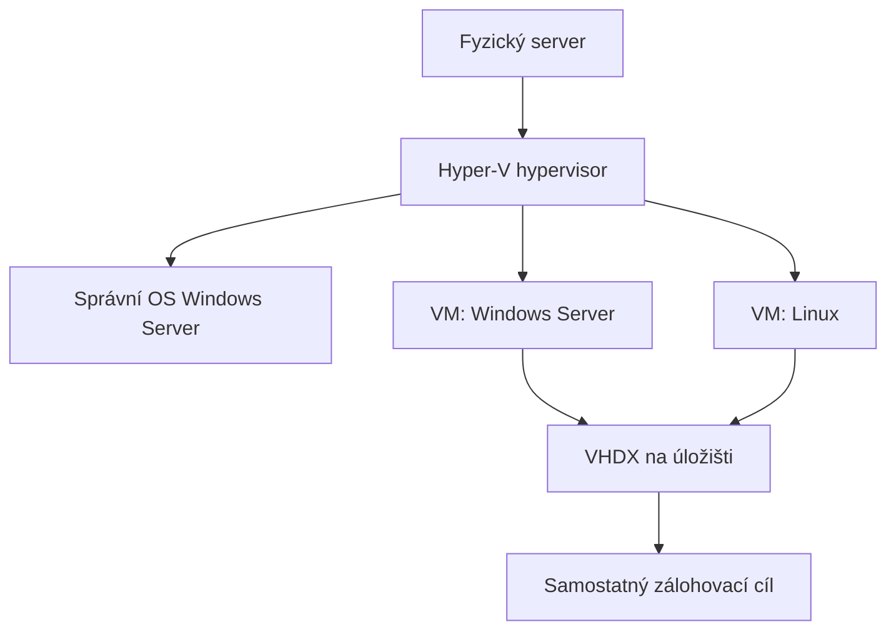

Here is the result of "fetch" for the Page with URL https://app.notion.com/p/403bceb1e413812a9c02f743f359b731 as of 2026-10-24T10:16:12.134Z:
<page url="https://app.notion.com/p/403bceb1e413812a9c02f743f359b731">
<ancestor-path>
<parent-page url="https://app.notion.com/p/403bceb1e413801d98a5dfd2c1d9d8b9" title="Student IT support"/>
</ancestor-path>
<properties>
{"title":"Hyper-V — praktická příručka pro nasazení a správu serverů"}
</properties>
<iconMetadata>null</iconMetadata>
<content>
Ověřeno: <date start="2026-10-24" />. PowerShell příklady spouštěj jako správce na <b>Hyper-V hostiteli</b>, pokud není uvedeno jinak.

<table-of-contents />

# 1. K čemu Hyper-V slouží

Hyper-V je hypervisor typu 1: umožňuje na jednom fyzickém serveru provozovat více izolovaných virtuálních počítačů s vlastním OS. Použiješ ho například pro Windows Server, Linux, aplikační server, testovací prostředí nebo monitoring.

<b>Hostitel</b> je fyzický server s Hyper-V, <b>guest/VM</b> je virtuální počítač. Hyper-V Manager je správní nástroj; samotná instalace správních nástrojů ještě neznamená, že server umí VM spouštět. Serverová varianta nabízí i migrace, replikaci a integraci s Failover Clustering. [Přehled Hyper-V](https://learn.microsoft.com/en-us/windows-server/virtualization/hyper-v/overview)



<b>Praktický návrh:</b> hostitele vyhraď virtualizaci a její správě; běžné aplikace dej do VM. Pád jediného fyzického serveru vyřadí všechny jeho VM, pokud nemáš další řešení dostupnosti.

# 2. Co připravit před instalací

- 64bitový CPU s <b>SLAT</b>, podporou virtualizace a VM Monitor Mode.
- V BIOS/UEFI zapnuté <b>Intel VT-x / AMD-V</b> a <b>DEP/NX/XD</b>.
- RAM pro správní OS i všechny hosty. Oficiální minimum 4 GB neber jako sizing produkce.
- Podporované řadiče, síťové karty, ovladače a firmware.
- Připravené úložiště pro VM, management IP, DNS, hostname a čas.
- Funkční vzdálenou konzoli serveru a plán záloh.

Před instalací ověř požadavky:

```powershell
systeminfo.exe
```

Když už hypervisor běží, výstup může místo jednotlivých požadavků oznámit, že byl detekován hypervisor. Pro VM uvnitř jiné VM potřebuješ podporovanou <b>nested virtualization</b>; pro první produkční nasazení zde počítáme s fyzickým serverem. [Požadavky Hyper-V](https://learn.microsoft.com/en-us/windows-server/virtualization/hyper-v/host-hardware-requirements)

### Edice a licence v praxi

Role Hyper-V není totéž jako právo provozovat libovolný počet Windows Server VM. Při licencování všech fyzických jader dává Standard práva na dvě virtuální prostředí; další se řeší dalším pokrytím licence. Datacenter při tomto modelu umožňuje neomezený počet Windows Server prostředí. Platí minimální počty licencovaných jader a další podmínky; u modelu licencování po VM jsou pravidla jiná.

Počítej také s CAL a licencemi aplikací podle jejich požadavků. <b>Technický počet vytvořených VM není licenční limit Hyper-V.</b> Konkrétní pokrytí ověř podle své smlouvy a aktuálních Product Terms. [Licenční pravidla Windows Server 2025](https://www.microsoft.com/licensing/guidance/Windows-Server-2025)

# 3. Instalace role Hyper-V

Nejprve nainstaluj a aktualizuj Windows Server, ovladače a firmware podle podpory výrobce. Pro vzdáleně spravovaný host je možný <b>Server Core</b>; pro lokální grafickou správu zvol Desktop Experience.

<b>GUI:</b> Server Manager → Manage → Add Roles and Features → Role-based installation → cílový server → <b>Hyper-V</b> → zahrnout nástroje správy → dokončit instalaci a restart.

<b>PowerShell na Windows Serveru:</b>

```powershell
# Nainstaluje roli; restart proveď v naplánovaném okně.
Install-WindowsFeature -Name Hyper-V -IncludeManagementTools

# Po vyhodnocení výsledku instalace a odstavení služeb:
Restart-Computer

# Po restartu:
Get-WindowsFeature Hyper-V
Get-Service vmms
```

Na Server Core se s management tools instaluje PowerShell modul; Hyper-V Manager použiješ z jiného počítače. Windows 11 má jiný instalační příkaz a podporované edice; tento postup je pro <b>Windows Server</b>. [Instalace Hyper-V](https://learn.microsoft.com/en-us/windows-server/virtualization/hyper-v/get-started/install-hyper-v)

# 4. Správa a první konfigurace

V Hyper-V Manageru zvol <b>Connect to Server</b>. V <b>Hyper-V Settings</b> nastav výchozí cesty pro konfigurace a virtuální disky. Modelový návrh: <code>D:\HyperV\VMs</code> a <code>D:\HyperV\VHDX</code>; disk D: musí existovat a mít dostatek místa.

Pro vzdálenou správu zajisti překlad DNS, práva a povolenou správu/firewall podle dokumentace. V doméně bývá ověřování přehlednější; workgroup vyžaduje zvláštní nastavení. Neřeš připojení plošným vypnutím firewallu nebo bezmyšlenkovitým <code>TrustedHosts *</code>.

Účet ve skupině <b>Hyper-V Administrators</b> má rozsáhlou kontrolu nad VM. Management drž ve správcovské síti, vzdálený přístup přes VPN nebo správcovský bod. [Vzdálená správa](https://learn.microsoft.com/en-us/windows-server/virtualization/hyper-v/manage/remotely-manage-hyper-v-hosts)

# 5. Síť: External, Internal a Private

<table fit-page-width="true" header-row="true">
<tr>
<td>
Switch
</td>
<td>
Kdo spolu komunikuje
</td>
<td>
Typické použití
</td>
</tr>
<tr>
<td>
External
</td>
<td>
VM a fyzická síť; podle nastavení také hostitel
</td>
<td>
Produkční LAN
</td>
</tr>
<tr>
<td>
Internal
</td>
<td>
VM na daném hostiteli a hostitel
</td>
<td>
Laboratoř, případně zvlášť nastavený NAT
</td>
</tr>
<tr>
<td>
Private
</td>
<td>
VM na daném hostiteli
</td>
<td>
Izolovaný test bez připojení hostitele
</td>
</tr>
</table>

V <b>Virtual Switch Manager</b> vytvoř External switch a vyber správný fyzický adaptér. Při sdílení s management OS používá hostitel virtuální adaptér <b>vEthernet</b>.

```powershell
Get-NetAdapter
# Mění síť; Ethernet2 musí být správná fyzická karta.
New-VMSwitch -Name 'vSwitch-LAN' -NetAdapterName 'Ethernet2' -AllowManagementOS $true
```

<b>Vytvoření switche může přerušit vzdálené spojení.</b> Měj konzoli iDRAC/iLO/IPMI. Poté ověř management IP, gateway a DNS.

VLAN se nastavuje na virtuální kartě VM; tag musí odpovídat fyzickému switchi:

```powershell
Set-VMNetworkAdapterVlan -VMName 'APP01' -Access -VlanId 20
```

Management VLAN má vlastní nastavení. External switch sám nedodává DHCP; Internal switch sám nezajišťuje internet. [Virtuální switche a VLAN](https://learn.microsoft.com/en-us/windows-server/virtualization/hyper-v/get-started/create-a-virtual-switch-for-hyper-v-virtual-machines)

# 6. Vytvoření první VM

<b>Modelový lehký Windows Server:</b> 2 vCPU, 4 GB startup RAM a 80 GB VHDX. Požadavky aplikace mají přednost.

1. Hyper-V Manager → <b>New → Virtual Machine</b>.
2. Nastav název <code>APP01</code> a cílovou složku.
3. Pro podporovaný moderní OS zvol <b>Generation 2</b>.
4. Přiděl startup RAM; dynamickou paměť zapínej podle služby.
5. Připoj <code>vSwitch-LAN</code> nebo izolovaný testovací switch.
6. Vytvoř VHDX, vyber instalační ISO a dokonči průvodce.
7. Ve Settings nastav CPU a ověř bootování.
8. Přes <b>Connect</b> otevři konzoli a nainstaluj OS.
9. Uvnitř VM nastav IP/DNS, aktualizace, aplikaci a její monitoring.
10. Ověř korektní vypnutí, restart a zálohu.

[Vytváření VM](https://learn.microsoft.com/en-us/windows-server/virtualization/hyper-v/get-started/create-a-virtual-machine-in-hyper-v)

<b>Generation 2</b> používá UEFI a podporuje Secure Boot. Generation 1 je pro potřebné starší systémy/obrazy. Generaci existující VM nelze přepnout běžnou změnou nastavení. U podporovaného Linuxu vyber vhodnou Secure Boot šablonu <b>Microsoft UEFI Certificate Authority</b>, pokud ji distribuce vyžaduje; nevypínej ochranu automaticky. [Generace VM](https://learn.microsoft.com/en-us/windows-server/virtualization/hyper-v/plan/should-i-create-a-generation-1-or-2-virtual-machine-in-hyper-v)

# 7. Přidělování CPU a paměti

<b>vCPU</b> je virtuální procesor plánovaný na fyzické CPU. Začni potřebným počtem a přidávej podle měření; více vCPU neodstraní pomalé storage.

U Dynamic Memory rozlišuj:

- <b>Startup RAM:</b> paměť pro start a instalaci/upgrady hostovaného OS.
- <b>Minimum RAM:</b> dolní mez po naběhnutí.
- <b>Maximum RAM:</b> horní mez, nikoli fyzicky rezervovaná kapacita.
- <b>Buffer/priority:</b> chování při přidělování dostupné paměti.

Příklad pro vypnutou testovací VM, jejíž OS/aplikace takové nastavení podporuje:

```powershell
Set-VM -Name 'APP01' -ProcessorCount 2
Set-VM -Name 'APP01' -DynamicMemory -MemoryMinimumBytes 2GB -MemoryStartupBytes 4GB -MemoryMaximumBytes 8GB
```

Pro aplikaci vyžadující pevnou paměť použij statické přidělení. Hostiteli nech rezervu a v clusteru plánuj kapacitu po výpadku uzlu. Dynamic Memory nevyrobí další fyzickou RAM. [Dynamická paměť](https://learn.microsoft.com/en-us/windows-server/virtualization/hyper-v/dynamic-memory), [Set-VM](https://learn.microsoft.com/en-us/powershell/module/hyper-v/set-vm)

# 8. Integration Services a automatický start

Integration Services zajišťují spolupráci hosta a hostitele: heartbeat, korektní vypnutí, čas a spolupráci při záloze. Potřebná služba musí fungovat na obou stranách. Moderní Windows je udržuje přes aktualizace; u Linuxu ověř podporu konkrétní distribuce.

```powershell
Get-VMIntegrationService -VMName 'APP01'
```

[Integration Services](https://learn.microsoft.com/en-us/windows-server/virtualization/hyper-v/manage/manage-hyper-v-integration-services)

U samostatného hostitele nastav automatický start a ukončení podle závislostí. Příklad:

```powershell
Set-VM -Name 'APP01' -AutomaticStartAction StartIfRunning -AutomaticStartDelay 60 -AutomaticStopAction ShutDown
```

Při restartu hostitele se má nejprve připravit infrastruktura a potom aplikace. Zpoždění není kontrola, že databáze či DNS už opravdu funguje. U clusterovaných VM koordinuje dostupnost cluster. [Možnosti startu a vypnutí](https://learn.microsoft.com/en-us/powershell/module/hyper-v/set-vm)

# 9. VHDX: vytvoření, přidání a zvětšení disku

<b>VHDX je soubor reprezentující disk VM.</b> Nezaměňuj ho s RAID virtual diskem na řadiči.

- <b>Fixed:</b> prostor se přidělí při vytvoření.
- <b>Dynamic:</b> soubor roste podle zápisů až k nastavenému limitu.
- <b>Differencing:</b> závisí na rodičovském disku; řetězec musí zůstat konzistentní.

Příklad nového datového disku; složka musí existovat, cesta nesmí patřit existujícímu disku:

```powershell
New-VHD -Path 'D:\HyperV\VHDX\APP01-data.vhdx' -SizeBytes 100GB -Dynamic
Add-VMHardDiskDrive -VMName 'APP01' -ControllerType SCSI -Path 'D:\HyperV\VHDX\APP01-data.vhdx'
```

Poté <b>uvnitř VM</b> nový prázdný disk inicializuj, vytvoř oddíl a filesystem. [New-VHD](https://learn.microsoft.com/en-us/powershell/module/hyper-v/new-vhd)

### Zvětšení existujícího disku

1. Ověř zálohu, správný soubor, místo na hostiteli a případné checkpointy.
2. Dokonči backup/merge; nezasahuj do aktivního checkpointového řetězce.
3. Pro jednoduchý první postup VM korektně vypni.
4. Rozšiř její VHDX; například ze 100 na 150 GB:

```powershell
Resize-VHD -Path 'D:\HyperV\VHDX\APP01-data.vhdx' -SizeBytes 150GB
```

5. Spusť VM a uvnitř rozšiř oddíl/filesystem do nového místa.

VHDX na SCSI podporuje online resize; IDE vyžaduje vypnutí. Oddíl uvnitř rozšiř zvlášť. [Resize-VHD](https://learn.microsoft.com/en-us/powershell/module/hyper-v/resize-vhd)

# 10. Checkpointy: krátkodobý návrat před změnou

<b>Standard checkpoint</b> zachytí i stav paměti. <b>Production checkpoint</b> využívá VSS ve Windows nebo filesystem freeze v Linuxu a neukládá běžící RAM. Ani produkční checkpoint uložený na stejném storage nenahrazuje nezávislou zálohu.

Pro produkční VM je užitečné zakázat tichý fallback na standardní checkpoint:

```powershell
Set-VM -Name 'APP01' -CheckpointType ProductionOnly
Checkpoint-VM -Name 'APP01' -SnapshotName 'Pred-zmenou'
Get-VMSnapshot -VMName 'APP01'
```

Po ověření změny odstraň konkrétní checkpoint přes Manager, případně:

```powershell
Remove-VMSnapshot -VMName 'APP01' -Name 'Pred-zmenou'
```

Hyper-V provede sloučení dat. <b>Nikdy ručně nemaž AVHDX soubory.</b> Nech dostatek místa a počkej na dokončení merge. Návrat checkpointu zahodí novější změny dané VM; u databází, AD a propojených aplikací musí být součástí aplikačního plánu obnovy. [Checkpointy](https://learn.microsoft.com/en-us/windows-server/virtualization/hyper-v/checkpoints)

# 11. Zálohování a test obnovy

Použij zálohovací řešení podporující tvoji verzi Hyper-V, způsob storage a aplikace. Záloha celé VM má obsahovat její konfiguraci i všechny potřebné disky/stav; prosté kopírování právě používaného VHDX není rovnocenný postup.

Moderní integrace využívá mimo jiné <b>RCT</b> pro sledování změněných bloků. Pro aplikační konzistenci Windows hostů může využívat <b>VSS</b> uvnitř VM. U databází řeš i jejich vlastní obnovu a historii transakcí. [Mechanismy záloh Hyper-V](https://learn.microsoft.com/en-us/windows-server/virtualization/hyper-v/backup-approaches)

<b>Praktický návrh politiky:</b> denní záloha, retence podle služby, další kopie mimo hlavní hostitel/storage a omezený přístup k mazání záloh. Frekvenci odvoď od <b>RPO</b> (přijatelná ztráta dat), dobu obnovy od <b>RTO</b> (přijatelný výpadek).

<b>Test obnovy:</b>

1. Obnov VM jako oddělenou testovací instanci.
2. Připoj ji do Private switche nebo jinak izolované sítě.
3. Ověř start OS, přihlášení, službu a skutečná aplikační data.
4. Změř čas obnovy a zapiš výsledek.
5. Testovací kopii bezpečně ukliď po kontrole.

Klon se stejnou IP/jménem nepatří současně do produkce. Pro domain controller používej dokumentovaný postup obnovy AD; samotný návrat VM checkpointu není obecný disaster recovery plán. [Virtualizované řadiče domény](https://learn.microsoft.com/en-us/windows-server/identity/ad-ds/get-started/virtual-dc/virtualized-domain-controllers-hyper-v)

# 12. Export, import a přesun VM

Export zachytí konfiguraci, disky a související checkpointové soubory. Hodí se pro přenos a laboratoř:

```powershell
Export-VM -Name 'APP01' -Path 'E:\VM-Exports'
```

Cíl musí existovat, mít kapacitu a správná oprávnění. <b>Import Virtual Machine</b> nabízí:

- <b>Register in-place:</b> používá soubory přímo tam, kde leží, a zachová ID.
- <b>Restore:</b> kopíruje soubory do cílového umístění, zachová ID.
- <b>Copy:</b> vytvoří novou identitu VM.

Nové ID Hyper-V samo nezmění hostname, IP nebo identitu OS uvnitř VM. Při přípravě šablony generalizuj systém odpovídajícím postupem.

Cílový host musí podporovat <b>configuration version</b> VM; upgrade této verze může znemožnit návrat na starší host. Neprováděj ho automaticky před ověřením migračního plánu. [Export a import](https://learn.microsoft.com/en-us/windows-server/virtualization/hyper-v/deploy/export-and-import-virtual-machines)

# 13. Live migration, cluster a Replica

<table fit-page-width="true" header-row="true">
<tr>
<td>
Funkce
</td>
<td>
Kdy ji použiješ
</td>
<td>
Co sama neřeší
</td>
</tr>
<tr>
<td>
Live Migration
</td>
<td>
Plánovaný přesun běžící VM s minimálním přerušením
</td>
<td>
Havárii již nefunkčního hostitele
</td>
</tr>
<tr>
<td>
Failover Cluster
</td>
<td>
Převzetí vysoce dostupné VM jiným uzlem po výpadku
</td>
<td>
Historii záloh a nulovou ztrátu běžícího stavu
</td>
</tr>
<tr>
<td>
Hyper-V Replica
</td>
<td>
Asynchronní kopii VM pro obnovu na jiném hostiteli/lokalitě
</td>
<td>
Samostatně automatický clusterový failover
</td>
</tr>
</table>

### Plánovaná migrace

Připrav kompatibilní CPU, verze hostitelů/VM, odpovídající switche, dostupnost disků, oprávnění a vyhrazenou důvěryhodnou migrační síť. Migrace je možná i bez Failover Clusteru.

Na obou hostitelích nastav Live Migrations a ověř ověřování. <b>Windows Server 2025 s aktivním Credential Guardem vyžaduje řešení místo CredSSP-based delegace — použij podporovanou omezenou delegaci Kerberos.</b> Vypnutí Credential Guardu není výchozí oprava. Konkrétní delegaci a storage oprávnění připrav podle topologie. [Live migration](https://learn.microsoft.com/en-us/windows-server/virtualization/hyper-v/deploy/set-up-hosts-for-live-migration-without-failover-clustering)

### Failover Cluster

V běžném doménovém návrhu připrav alespoň dva podporované uzly, síť, AD/DNS a podporované sdílené nebo distribuované storage. Nainstaluj <b>Failover Clustering</b>, proveď <b>Validate Configuration</b>, vytvoř cluster a VM přidej jako vysoce dostupnou roli. U běžících produkčních disků plánuj validaci: některé storage testy mohou být rušivé.

Při pádu uzlu se VM na druhém uzlu zpravidla znovu spouští; nejde o zachování RAM z havarovaného serveru. Nech dostatek kapacity pro převzetí zátěže. [Vytvoření clusteru](https://learn.microsoft.com/en-us/windows-server/failover-clustering/create-failover-cluster)

Nastav <b>quorum witness</b> podle návrhu, typicky file share, cloud nebo disk witness. Witness pomáhá rozhodnout o většině hlasů; není úložištěm VM ani zálohou. [Quorum a witness](https://learn.microsoft.com/en-us/windows-server/failover-clustering/deploy-quorum-witness)

### Hyper-V Replica

Na cílovém hostiteli povol Replica, nastav ověřování a povolené zdroje. Na VM spusť <b>Enable Replication</b>, vyber cílový server, zahrnuté disky, interval a obnovovací body; následně proveď prvotní synchronizaci.

Sleduj stav replikace a nacvič <b>Test Failover</b> v izolované síti. Při havárii rozhodni, která strana smí běžet, aby nevznikly dvě aktivní kopie stejné služby. Replika může obsahovat i přenesené smazání či poškození; potřebuješ také zálohu. [Nastavení Replica](https://learn.microsoft.com/en-us/windows-server/virtualization/hyper-v/replication-virtual-machines)

# 14. Tahák příkazů

Nejdříve diagnostika; jméno <code>APP01</code> nahraď skutečnou VM.

```powershell
Get-VM
Get-VMHost
Get-VMSwitch
Get-VMNetworkAdapter -VMName 'APP01'
Get-VMHardDiskDrive -VMName 'APP01'
Get-VMMemory -VMName 'APP01'
Get-VMProcessor -VMName 'APP01'
Get-VMIntegrationService -VMName 'APP01'
Get-VMSnapshot -VMName 'APP01'
Get-VMReplication
Get-Volume
Get-Service vmms
```

Příkazy měnící stav:

```powershell
Start-VM -Name 'APP01'
Stop-VM -Name 'APP01'
```

Běžné <code>Stop-VM</code> požádá hostovaný OS o vypnutí. <code>-TurnOff</code> odpovídá odpojení napájení; použij ho jen jako vyhodnocený nouzový zásah. U clusterové VM respektuj clusterovou správu. Parametry ověř přes <code>Get-Help Stop-VM -Full</code>. [Vypnutí VM a parametry Stop-VM](https://learn.microsoft.com/en-us/powershell/module/hyper-v/stop-vm?view=windowsserver2025-ps)

# 15. Diagnostika typických potíží

<b>VM nejde spustit:</b> přesná chyba → dostupná startup RAM → místo a dostupnost VHDX → práva → generace/bootování → stav hypervisoru. U hlášky „hypervisor is not running“ ověř virtualizaci a DEP v BIOS/UEFI a dokončený restart. [Diagnostika hypervisoru](https://learn.microsoft.com/en-us/troubleshoot/windows-server/virtualization/virtual-machine-not-started-hypervisor-not-running)

<b>VM nemá síť:</b> karta připojená ke správnému switchi → VLAN → fyzický uplink → IP/maska/gateway → DNS → firewall. Vytvoření vSwitche samo nezajistí IP.

<b>VM je pomalá nebo Paused-Critical:</b> ověř volné místo, dostupnost úložiště, latency, RAM a checkpointy. Přidání vCPU neopraví zahlcený RAID. [Výkon a zdroje](https://learn.microsoft.com/en-us/troubleshoot/windows-server/virtualization/troubleshoot-hyper-v-virtual-machine-performance)

<b>Záloha/checkpoint selhává:</b> ověř integrační služby, stav VSS uvnitř Windows VM, kapacitu a současně běžící operace. Nemaž AVHDX ručně.

Začni časem chyby a logy:

```powershell
Get-WinEvent -LogName 'Microsoft-Windows-Hyper-V-VMMS-Admin' -MaxEvents 30
Get-WinEvent -LogName 'Microsoft-Windows-Hyper-V-Worker-Admin' -MaxEvents 30
```

[Diagnostické logy a stavy VM](https://learn.microsoft.com/en-us/troubleshoot/windows-server/virtualization/hyper-v-start-state-access-failures-clustered-standalone)

# 16. Předání do provozu a první cvičení

Praktický kontrolní seznam:

- [ ] Zapsaný hostitel, verze OS, management IP, switche/VLAN a umístění VM.
- [ ] Aktualizace, firmware a ovladače odpovídají podporované konfiguraci.
- [ ] Ověřená vzdálená konzole a omezené správcovské přístupy.
- [ ] Otestovaný restart hostitele a korektní start/vypnutí hostů.
- [ ] Dostatek RAM, kapacity storage a prostor pro dočasné checkpointy.
- [ ] Automatické zálohy, oznámení chyb a ověřená obnova aplikace.
- [ ] Zapsaná licence, správce služby, RPO/RTO a závislosti.
- [ ] U clusteru validace, witness a test výpadku/převzetí.

<b>Denně:</b> chyby VM, storage, záloh a replikace. <b>Pravidelně:</b> aktualizace, růst kapacit a test obnovy. <b>Před zásahem:</b> záloha, konzole, servisní okno a postup návratu.

<b>Laboratoř:</b> vytvoř Gen 2 VM → připoj síť → přidej datový VHDX → uvnitř vytvoř testovací soubor → udělej production checkpoint → změň soubor a vyzkoušej návrat → checkpoint odstraň → vytvoř skutečnou zálohu/export → otestuj oddělenou obnovenou kopii.

Příbuzná příručka: <mention url="https://app.notion.com/p/403bceb1e413811cb04ef027bd9f8715" />.
</content>
</page>
