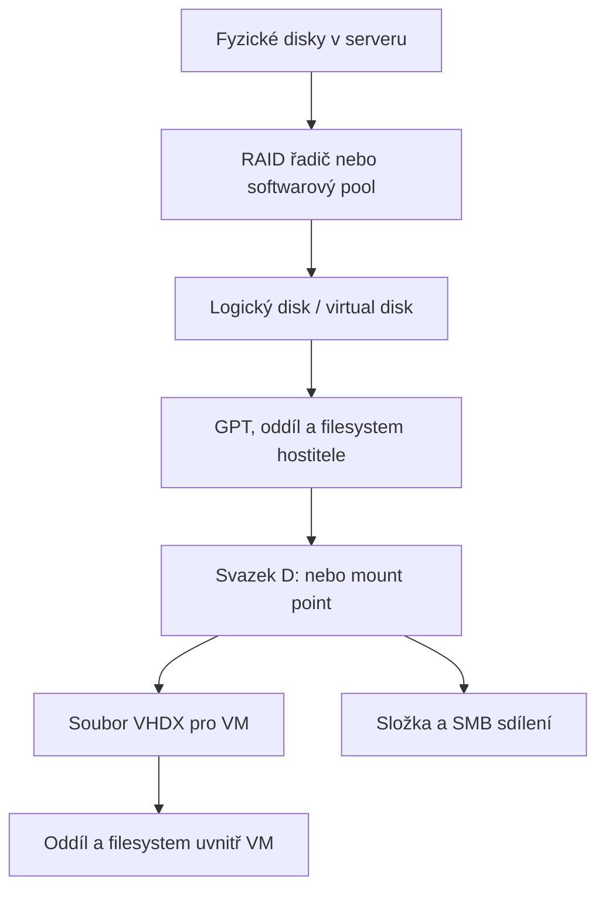

Here is the result of "fetch" for the Page with URL https://app.notion.com/p/403bceb1e41381a485bcc52395b7bd7e as of 2026-10-24T10:16:16.818Z:
<page url="https://app.notion.com/p/403bceb1e41381a485bcc52395b7bd7e">
<ancestor-path>
<parent-page url="https://app.notion.com/p/403bceb1e413801d98a5dfd2c1d9d8b9" title="Student IT support"/>
</ancestor-path>
<properties>
{"title":"Disková pole na serverech — RAID, nastavení a přidělování úložiště"}
</properties>
<iconMetadata>null</iconMetadata>
<content>
Ověřeno: <date start="2026-10-24" />. Příkazy jsou příklady pro Windows Server 2022/2025; nejsou určené ke spuštění naslepo na existujícím poli.

<table-of-contents />

# 1. Jaké vrstvy úložiště nastavuješ

<b>Diskové pole</b> spojuje fyzické disky kvůli kapacitě, výkonu nebo odolnosti. V praxi potřebuješ rozlišovat několik vrstev:



- <b>Physical disk:</b> konkrétní SSD/HDD, slot a sériové číslo.
- <b>Array/disk group/pool:</b> skupina disků spravovaná jednou technologií.
- <b>Virtual disk/logical drive:</b> blokové zařízení vytvořené řadičem nebo Storage Spaces.
- <b>Partition/volume:</b> oddíl a naformátovaný svazek pro OS.
- <b>VHDX:</b> soubor představující disk virtuálního počítače.
- <b>LUN:</b> blokové úložiště prezentované serveru ze SAN.
- <b>Share:</b> síťově zpřístupněná složka; nepředává klientovi správu celého disku.

<b>Příklad:</b> přidání fyzického disku samo nezvětší D: ani disk ve VM. Změnu musíš provést na potřebných navazujících vrstvách. [Princip poolu a virtual disků](https://learn.microsoft.com/en-us/windows-server/storage/storage-spaces/overview)

# 2. Rozhodni, kdo bude disky spravovat

<table fit-page-width="true" header-row="true">
<tr>
<td>
Varianta
</td>
<td>
Kdo spravuje redundanci
</td>
<td>
Typické použití
</td>
</tr>
<tr>
<td>
Hardwarový RAID
</td>
<td>
Samostatný řadič; OS obvykle vidí logické disky
</td>
<td>
Server s podporovaným RAID řadičem
</td>
</tr>
<tr>
<td>
Storage Spaces
</td>
<td>
Windows nad přímo dostupnými disky
</td>
<td>
Softwarový pool na samostatném serveru
</td>
</tr>
<tr>
<td>
ZFS
</td>
<td>
ZFS nad přímo dostupnými disky
</td>
<td>
Například Proxmox se ZFS
</td>
</tr>
<tr>
<td>
Externí SAN/NAS
</td>
<td>
Úložiště mimo server
</td>
<td>
Blokové LUN nebo souborové sdílení
</td>
</tr>
</table>

Pro <b>Storage Spaces</b> potřebuje Windows vhodné disky dostupné jednotlivě; RAID vrstva skrývající disky není jeho běžnou podporovanou podkladovou konfigurací. Pro <b>ZFS</b> také použij přímý přístup/HBA místo hardwarového RAIDu s vlastní správou cache. [Požadavky Storage Spaces](https://learn.microsoft.com/en-us/windows-server/storage/storage-spaces/deploy-standalone-storage-spaces), [ZFS v Proxmoxu](https://github.com/proxmox/pve-docs/blob/master/local-zfs.adoc)

Přepnutí řadiče <b>RAID ↔ HBA/JBOD</b> je změna architektury, ne kosmetické nastavení. Na serveru s daty nejprve zjisti důsledky pro konkrétní řadič a připrav migraci/obnovu.

# 3. RAID úrovně a využitelná kapacita

Pro stejně velké disky: <b>N</b> = počet členů pole, <b>S</b> = kapacita jednoho disku. U nestejných kapacit běžně omezuje využití nejmenší člen. Níže je orientační kapacita před metadata/filesystemem; hot spare se do ní nezapočítává.

<table fit-page-width="true" header-row="true">
<tr>
<td>
RAID
</td>
<td>
Běžné minimum
</td>
<td>
Kapacita
</td>
<td>
Tolerance výpadku
</td>
</tr>
<tr>
<td>
0
</td>
<td>
2 pro striping
</td>
<td>
N × S
</td>
<td>
Žádný disk
</td>
</tr>
<tr>
<td>
1
</td>
<td>
2
</td>
<td>
S u dvojice
</td>
<td>
Jeden disk dvojice
</td>
</tr>
<tr>
<td>
5
</td>
<td>
3
</td>
<td>
(N − 1) × S
</td>
<td>
Jeden disk
</td>
</tr>
<tr>
<td>
6
</td>
<td>
4
</td>
<td>
(N − 2) × S
</td>
<td>
Dva disky
</td>
</tr>
<tr>
<td>
10
</td>
<td>
4, typicky sudý počet
</td>
<td>
(N / 2) × S
</td>
<td>
Jeden disk v každém mirror páru
</td>
</tr>
</table>

<b>RAID 10 nepřežije libovolné dva vadné disky:</b> dva členové stejného páru znamenají ztrátu pole. RAID 5/6 mají paritní režii při zápisu; mirror/RAID 10 bývá vhodný pro náhodné I/O. RAID 0 použij jen tam, kde ztrátu dat opravdu akceptuješ.

<b>RAID není záloha.</b> Nechrání před smazáním, ransomwarem ani ztrátou celého zařízení. [RAID úrovně a vlastnosti](https://www.dell.com/support/kbdoc/en-us/000128635/dell-servers-what-are-the-raid-levels-and-their-specifications)

### Vzorový výpočet a návrh

<b>Vlastní výpočet podle kapacitních vztahů RAID:</b> šest 2TB disků:

- RAID 6: přibližně <b>8 TB</b> využitelné kapacity.
- RAID 10: přibližně <b>6 TB</b>.
- Pět disků v RAID 6 + šestý jako spare: přibližně <b>6 TB</b>.

[Kapacitní vztahy RAID](https://dl.dell.com/topicspdf/dell-opnmang-srvr-admin-v8.0.1_glossary_en-us.pdf)

Jednotky výrobce TB a binární TiB nejsou stejné: 8 TB odpovídá přibližně 7,28 TiB před další režií. Rozdíl zobrazení proto nemusí znamenat ztracený disk.

<b>Modelový návrh:</b> dva menší SSD v mirroru pro OS, oddělená skupina SSD pro VM a zálohy mimo tento server. Je to výchozí možnost, nikoli povinná architektura. Dva oddíly na jednom poli stále sdílejí výkon i poruchu pole.

# 4. Co zjistit před změnou

Praktický inventář:

- Model serveru, řadiče, firmware a režim RAID/HBA.
- Počet slotů, podporované SAS/SATA/NVMe, formát sektorů a kompatibilita disků.
- U každého disku <b>slot, sériové číslo, model, kapacita a stav</b>.
- Které disky obsahují OS, které data, které jsou skutečně volné.
- Stav existujících polí, záloh, UPS a ochrany cache.
- Požadovaná kapacita, růst dat, IOPS, propustnost a přípustná latence.

<b>IOPS</b> jsou operace za sekundu, <b>MB/s</b> objem přenosu a <b>latence</b> doba odezvy. Databáze a VM potřebují jiné chování než sekvenční archiv. Ověř výkon při reprezentativní zátěži, nejen kopírováním jednoho velkého souboru.

U náhradního disku ověř přesnou kompatibilitu; marketingově stejná kapacita nemusí stačit. Nezaměňuj SSD endurance, ochranu při výpadku napájení a běžnou spotřebitelskou kapacitu.

<callout icon="⚠️" color="yellow_bg">
<b>Create/Delete array, Initialize, Clear configuration a Format mohou zničit přístup k datům.</b> Návod pro založení nového pole nepatří na neznámé pole s existujícími daty. Rozhodující je identita disků a ověřená obnova ze zálohy.
</callout>

# 5. Vytvoření hardwarového pole krok za krokem

Příklad <b>Dell PERC + iDRAC9</b>; u jiného výrobce najdi odpovídající storage utility.

1. Přihlas se do iDRAC a otevři <b>Storage</b>. Starší firmware může mít <b>Configuration → Storage Configuration</b>.
2. Zkontroluj správný řadič a fyzické disky podle slotů/sériových čísel.
3. Vyber <b>Create Virtual Disk</b>.
4. Zvol konkrétní nepoužívané disky a požadovaný RAID.
5. Nastav název, kapacitu a podporované parametry.
6. Zkontroluj souhrn, přidej operaci do fronty a použij <b>Apply Now</b> nebo plánované provedení.
7. Sleduj <b>Job Queue</b> a dokončení konfigurace.
8. Ověř stav vytvořeného virtual disku i případnou inicializaci na pozadí.
9. V OS proveď rescan; teprve pak inicializaci nového OS disku a vytvoření svazku.

<b>Fast initialization není bezpečné smazání starých dat.</b> Vytvoření či inicializace starého pole ale může zničit jeho metadata; nezaměňuj to s obnovou. [Vytvoření virtual disku v iDRAC9](https://www.dell.com/support/kbdoc/en-us/000129249/dell-poweredge-how-to-create-a-virtual-disk-using-idrac-9)

# 6. Stripe size, cache a hot spare

<b>Stripe/strip size</b> určuje rozdělování bloků mezi členy pole; není totéž co velikost alokační jednotky NTFS/ReFS. Začni podporovaným nastavením výrobce pro danou zátěž, změny podlož měřením.

<b>Write-through:</b> řadič potvrzuje zápis po předání na diskový subsystém. <b>Write-back:</b> může potvrdit zápis už v cache; bezpečnost závisí na funkční ochraně cache a podporovaném chování celé sestavy. UPS nenahrazuje ochranu proti selhání řadiče.

Nevynucuj write-back bez funkční ochrany kvůli výkonu. U některých řadičů porucha baterie/cache způsobí přepnutí na write-through a výrazné zpomalení. [Pravidla write cache](https://www.dell.com/support/manuals/en-us/dell-openmanage-server-administrator-v8.3/omss_ug/write-policy?guid=guid-5416e427-5348-46b9-9642-11a92e079035&lang=en-us), [Příklad degradované ochrany cache](https://www.dell.com/support/kbdoc/en-ie/000038067/faulty-perc-battery-on-dd3300)

<b>Hot spare</b> je kompatibilní rezervní disk pro obnovu po selhání člena. Global spare může obsloužit způsobilá pole řadiče, dedicated spare konkrétní pole. Nezvyšuje běžnou datovou kapacitu a neodstraní dobu rebuildu. U PERC ověř shodnou technologii a dostatečnou velikost. [Hot spare](https://www.dell.com/support/kbdoc/en-us/000178190/dell-poweredge-how-to-assign-a-hard-drive-in-global-hot-spare)

# 7. Z nového logického disku udělej svazek Windows

<b>Platí pouze pro nový prázdný disk.</b> Jestli disk, který dřív obsahoval data, náhle hlásí RAW/Not initialized, neinicializuj ho jako opravu.

1. Otevři <b>Disk Management</b> (<code>diskmgmt.msc</code>).
2. Proveď <b>Rescan Disks</b> a identifikuj disk podle kapacity a identifikátoru.
3. U nového lokálního disku podle potřeby nastav Online.
4. Zvol <b>Initialize Disk → GPT</b>.
5. Na nepřiděleném místě vytvoř <b>New Simple Volume</b>.
6. Zvol velikost, písmeno nebo prázdnou složku jako mount point.
7. Vyber filesystem, název svazku a dokonči formátování.
8. Ověř kapacitu, zápis/čtení a následně přístupy.

U sdíleného clusterového LUN nejprve respektuj postup clusteru; nezapínej a neformátuj jej nezávisle na každém uzlu.

```powershell
# Pouze přehled, nic nemění:
Get-Disk | Select-Object Number,FriendlyName,SerialNumber,UniqueId,Size,PartitionStyle,IsBoot,IsSystem,OperationalStatus
Get-Partition
Get-Volume
```

<b>GPT</b> je výchozí volba moderního serveru a řeší i disky větší než běžný limit MBR kolem 2 TiB. [Inicializace nového disku](https://learn.microsoft.com/en-us/windows-server/storage/disk-management/initialize-new-disks)

### NTFS nebo ReFS?

<b>NTFS:</b> univerzální kompatibilita a podpora funkcí jako FSRM. <b>ReFS:</b> vhodný pro podporované datové/virtualizační scénáře, například efektivní operace s virtuálními disky. Není automaticky nejlepší pro každou aplikaci ani náhradou RAIDu/záloh.

ReFS může opravovat poškození s pomocí redundantních kopií při podporované integraci se Storage Spaces; na libovolném hardwarovém RAIDu tím nevzniká stejná automatická opravná schopnost. Volbu filesystemu a alokační jednotky ověř podle aplikace, zálohovacího nástroje a verze OS. [ReFS](https://learn.microsoft.com/en-us/windows-server/storage/refs/refs-overview)

# 8. Storage Spaces na samostatném Windows Serveru

Vrstvy: <b>fyzické disky → storage pool → virtual disk → volume</b>. Systémový Windows disk do tohoto datového poolu nezahrnuj; samotný Storage Space není bootovací disk pro instalaci Windows.

V Server Manager → <b>File and Storage Services → Storage Pools</b>:

1. Vytvoř <b>New Storage Pool</b> z přesně vybraných vhodných volných disků.
2. V poolu vytvoř <b>New Virtual Disk</b>.
3. Vyber <b>Simple / Mirror / Parity</b>, kapacitu a <b>Thin / Fixed</b>.
4. Vytvoř volume, mount point a filesystem.
5. Ověř stav a kapacitu poolu.

Simple nemá redundanci. U standalone Storage Spaces vyžaduje two-way mirror nejméně dva disky, three-way mirror nejméně pět; nepřenášej tato pravidla automaticky na S2D.

```powershell
Get-PhysicalDisk | Select-Object FriendlyName,SerialNumber,Size,CanPool,HealthStatus,OperationalStatus
Get-StoragePool -IsPrimordial $false
Get-VirtualDisk
Get-StorageJob
```

Nevybírej všechny <code>CanPool=True</code> disky do hromadného zápisového příkazu bez ověření identity. [Postup nasazení Storage Spaces](https://learn.microsoft.com/en-us/windows-server/storage/storage-spaces/deploy-standalone-storage-spaces)

<b>Storage Spaces Direct (S2D)</b> propojuje interní disky více clusterových serverů. Je to další architektura s vlastními požadavky na hardware, síť, odolnost a edici; není totožná s vytvořením lokálního poolu. [S2D](https://learn.microsoft.com/en-us/windows-server/storage/storage-spaces/storage-spaces-direct-overview)

# 9. Přidělení místa VM, aplikaci a uživatelům

### Virtuálnímu serveru

Na svazku hostitele vytvoř samostatný VHDX a připoj jej konkrétní VM. Uvnitř VM teprve založ oddíl a filesystem. Datový disk můžeš oddělit od systémového kvůli správě a růstu; pokud oba leží na stejném poli, stále sdílejí jeho poruchu a výkon.

<b>Dynamic VHDX není totéž jako Windows dynamic disk.</b> První označuje rostoucí soubor virtuálního disku, druhé jiný způsob správy disků uvnitř Windows. [Virtuální disky Hyper-V](https://learn.microsoft.com/en-us/powershell/module/hyper-v/new-vhd)

### Uživatelům přes SMB

Na souborovém serveru připrav složku a SMB sdílení, například <code>D:\Shares\Projekty</code> → <code>\\FS01\Projekty</code>. Oprávnění nastav skupinám podle rolí; ověř <b>share permissions i filesystem ACL</b>. Písmeno disku namapované klientovi nevytváří vlastní kapacitu.

Postup: vytvoř složku → nastav NTFS práva → vytvoř SMB share → nastav přístupy share → otestuj z klienta účtem běžného uživatele. Ověř čtení, zápis i odmítnutí nepovoleného přístupu. [SMB sdílení](https://learn.microsoft.com/en-us/powershell/module/smbshare/new-smbshare)

### Kvóty a omezení spotřeby

FSRM umožňuje kvóty na složky/svazky, šablony a upozornění. <b>Hard quota</b> zastaví další zápis nad limit, <b>soft quota</b> pouze sleduje a upozorňuje.

Příklad vlastní politiky: oddělení má 300 GB, upozornění při 80 % a 90 %, hard limit podle dohody. Kvóta nezvětší fyzické pole ani nenahrazuje monitoring volného místa. [Správa kvót](https://learn.microsoft.com/en-us/windows-server/storage/fsrm/quota-management)

<b>FSRM podporuje NTFS, nikoli ReFS.</b> Volbu filesystemu tedy rozhodni před návrhem kvót. [Podpora FSRM](https://learn.microsoft.com/en-us/windows-server/storage/fsrm/fsrm-overview)

# 10. Thin provisioning: kde může dojít místo

U <b>thin</b> virtual disku se kapacita poolu zabírá postupně, u <b>fixed</b> je přidělována při vytvoření s ohledem na redundanci. U mirroru potřebuje fyzické uložení více kopií; 1 TB logických dat není 1 TB fyzické spotřeby.

Thin může existovat na několika vrstvách současně: SAN/pool → svazek → dynamic VHDX. Proto sleduj <b>všechny vrstvy</b>. Volných 100 GB uvnitř VM nezaručuje volné místo na hostiteli nebo SAN.

Praktický návrh: nastav varování podle rychlosti růstu a času na dodání kapacity. Pro začátek může posloužit 80 %/90 %, ale není to univerzální bezpečná hranice. Rezervuj místo i na snapshoty, rebuild/opravu a provozní špičky. [Typy přidělení kapacity](https://github.com/MicrosoftDocs/windows-driver-docs/blob/staging/windows-driver-docs-pr/storage/msft-virtualdisk.md)

# 11. Rozšíření kapacity: od pole ke svazku

### Hardwarový RAID

1. Ověř zdravé pole, obnovitelnou zálohu a podporu <b>OCE/RLM</b> konkrétního řadiče.
2. Zkontroluj kompatibilitu a identitu přidávaných disků.
3. V nástroji řadiče spusť podporované rozšíření/reconfigure.
4. Sleduj dokončení; po dobu operace počítej s poklesem výkonu.
5. Zvětši virtual disk, pokud to není součást předchozí operace.
6. V OS proveď rescan a potom rozšiř oddíl/filesystem.

<b>Online Capacity Expansion (OCE)</b> rozšiřuje kapacitu; <b>RAID Level Migration (RLM)</b> mění RAID. Dostupnost se liší podle konfigurace. U některých PERC sestav více virtual disků na stejné skupině nebo RAID 50/60 rozšíření omezuje.

Výměna jednoho člena za větší disk automaticky nezvětší celé pole. Před postupnou výměnou všech disků ověř, že cílové rozšíření výrobce podporuje. Jinak naplánuj nové pole a migraci dat. [Rozšíření a změna RAIDu](https://www.dell.com/support/kbdoc/en-us/000116592/how-reconfigure-a-virtual-disk-or-add-additional-hard-drives)

### Oddíl Windows

V Disk Management použij <b>Extend Volume</b>. U běžného basic disku musí být volné místo za rozšiřovaným oddílem na stejném disku. Pokud mezi nimi leží Recovery partition, samotné zvětšení podkladového disku nestačí; tento oddíl nemaž naslepo. [Rozšíření svazku](https://learn.microsoft.com/en-us/windows-server/storage/disk-management/extend-a-basic-volume)

PowerShell příklad pro <b>ověřený svazek D:</b>:

```powershell
Get-Partition -DriveLetter D
Get-Volume -DriveLetter D
$volumeResizeLimits = Get-PartitionSupportedSize -DriveLetter D

# Náhled operace:
Resize-Partition -DriveLetter D -Size $volumeResizeLimits.SizeMax -WhatIf

# Až po kontrole identity, zálohy a požadované velikosti:
Resize-Partition -DriveLetter D -Size $volumeResizeLimits.SizeMax
```

Tento příklad využije maximum; pokud chceš část místa ponechat volnou, zvol menší cílovou velikost. [Resize-Partition](https://learn.microsoft.com/en-us/powershell/module/storage/resize-partition)

### Modelový požadavek: zvětšit datový disk VM ze 100 na 150 GB

- Zjisti, kde leží VHDX a zda hostitel/pool/SAN mají rezervu.
- Ověř zálohu a checkpointový řetězec; pro jednoduchý první postup VM vypni.
- Na hostiteli zvětši správný VHDX na 150 GB.
- Uvnitř VM po startu rozšiř její datový oddíl.
- Ověř novou kapacitu, aplikaci a další zálohu.

```powershell
# Na Hyper-V hostiteli, po kontrole cesty:
Resize-VHD -Path 'D:\HyperV\VHDX\APP01-data.vhdx' -SizeBytes 150GB
```

Zvětšit soubor VHDX a rozšířit filesystem uvnitř jsou dvě různé operace. [Resize-VHD](https://learn.microsoft.com/en-us/powershell/module/hyper-v/resize-vhd)

# 12. SAN, iSCSI a více cest k úložišti

U externího pole vytvoříš volume/LUN, zpřístupníš jej správnému hostiteli a teprve potom ho zpracuje OS. <b>iSCSI initiator</b> je klient na serveru; <b>target</b> je služba na úložišti. Přístup omez podle správných identifikátorů initiatorů a návrhu sítě.

Typický postup:

1. Připrav oddělenou storage síť a adresaci.
2. Na poli vytvoř LUN a přiřaď jej správnému hostiteli.
3. Ve Windows nakonfiguruj iSCSI Initiator, target portály a trvalé spojení.
4. Pro více cest nastav <b>MPIO</b> a výrobcem podporovanou politiku/DSM.
5. Ověř, že více cest představuje <b>jeden disk</b>, nikoli nezávislé kopie.
6. Teprve podle účelu inicializuj nový LUN nebo jej přidej do clusteru.
7. Nacvič ztrátu jedné cesty v servisním okně.

MPIO není RAID ani náhrada záloh. Dvě síťové karty bez správné topologie a multipath konfigurace nezajistí dostupnost. [iSCSI a MPIO diagnostika](https://learn.microsoft.com/en-us/troubleshoot/windows-server/backup-and-storage/iscsi-storage-connectivity-troubleshooting)

<b>Běžný NTFS/ReFS LUN nesmí nezávisle zapisovat více neclusterovaných hostů.</b> Sdílený přístup vyžaduje podporovaný clusterový mechanismus nebo souborovou službu. U Hyper-V se používají například Cluster Shared Volumes; pouhé připojení stejného LUN ke dvěma serverům nevytvoří cluster. [Cluster a dostupnost storage](https://learn.microsoft.com/en-us/windows-server/failover-clustering/create-failover-cluster)

# 13. Vadný disk: výměna a rebuild

<b>Degraded</b> obvykle znamená ztracenou část odolnosti. <b>Failed/Offline</b> může znamenat nedostupné pole. Příčina více současně chybějících disků může být řadič, napájení nebo backplane, ne souběžná porucha všech médií.

Praktický postup pro podporované redundantní pole:

1. Zkontroluj logy řadiče a stav všech členů.
2. Ověř poslední použitelnou zálohu a dopad na provoz.
3. Vadný kus identifikuj <b>slotem i sériovým číslem</b>, případně Locate LED.
4. Ověř náhradní disk a podporu hot-swap; jinak naplánuj vypnutí.
5. Vyměň pouze určený disk podle servisního postupu serveru.
6. Ověř začátek rebuildu nebo proveď podporovanou ruční akci.
7. Sleduj průběh, chyby a konečný zdravý stav.

Během rebuildu je výkon nižší a odolnost omezená. Nevytahuj další člen a neruš rebuild bez důvodu. Nově vložený disk ještě neznamená obnovenou redundanci. [Rebuild a vliv na provoz](https://www.dell.com/support/manuals/en-us/poweredge-r640/idrac_3.31.31.31_ug/rebuild-physical-disk?guid=guid-a7cf3b2a-8249-4d4d-9c40-d6be2036ca68&lang=en-us)

### Foreign configuration

Řadič může na disku najít RAID metadata, která neodpovídají aktuální konfiguraci. <b>Import Foreign</b> a <b>Clear Foreign</b> nejsou zaměnitelné akce.

Nejprve zjisti, odkud disky pocházejí, zda jsou přítomné všechny potřebné členy a jaký stav čekáš. U přesunu původního pole nebo havárie řadiče může být import součást obnovy. Clear může odstranit metadata potřebná k návratu. Nepoužívej „initialize“ jako první reakci na neznámé pole. [PERC: foreign metadata a obnovovací situace](https://dl.dell.com/manuals/all-products/esuprt_ser_stor_net/esuprtl_adapters/poweredge-rc-h830_User%27s%20Guide_en-us.pdf)

# 14. Monitoring a příkazový tahák

Ve Windows, pouze čtení:

```powershell
Get-Disk
Get-Partition
Get-Volume
Get-PhysicalDisk | Select-Object FriendlyName,SerialNumber,HealthStatus,OperationalStatus,Size
Get-StoragePool -IsPrimordial $false
Get-VirtualDisk | Select-Object FriendlyName,ResiliencySettingName,ProvisioningType,HealthStatus,OperationalStatus,Size,FootprintOnPool
Get-StorageJob
```

<b>U hardwarového RAIDu nemusí Get-PhysicalDisk ukazovat skutečné členy pole.</b> Kontroluj také iDRAC nebo oficiální nástroj řadiče. Výstup „Healthy“ logického OS disku sám nepotvrzuje zdraví všech fyzických disků.

Sleduj:

- predictive failure, media errors, stav jednotlivých členů a pole;
- ochranu cache, teploty a firmware;
- kapacitu poolu, svazků, VHDX a zálohovacího cíle;
- latenci a vytížení během běžného provozu, backupu a rebuildu;
- stav consistency check/patrol read/scrub podle technologie.

<b>Consistency check, scrub a patrol read nejsou stejná úloha.</b> Plánuj podporované kontroly podle dokumentace; prověř skutečné doručení upozornění. [Operace s virtual disky PERC](https://www.dell.com/support/manuals/en-uk/oth-t550/idrac9_7.xx_ug/managing-virtual-disks?guid=guid-f76cf234-bb9d-4b38-be2c-a28aa5bc4423&lang=en-us)

# 15. Nejčastější problémy a první kontrola

<table fit-page-width="true" header-row="true">
<tr>
<td>
Příznak
</td>
<td>
Co nejdřív ověřit
</td>
</tr>
<tr>
<td>
OS nevidí nový disk
</td>
<td>
Dokončení RAID úlohy, správný řadič, ovladač, rescan; u SAN mapping a spojení
</td>
</tr>
<tr>
<td>
Disk je vidět, ale nemá písmeno
</td>
<td>
Oddíl, filesystem, mount point; u nového prázdného disku dokonči vytvoření svazku
</td>
</tr>
<tr>
<td>
Starý disk náhle RAW
</td>
<td>
Logy a spojení; nic neformátuj, nejprve diagnostika a plán obnovy
</td>
</tr>
<tr>
<td>
Extend Volume je šedé
</td>
<td>
Nepřidělené místo za oddílem a správnou podkladovou kapacitu
</td>
</tr>
<tr>
<td>
VM má větší VHDX, ale stejný D:
</td>
<td>
Rozšíření oddílu/filesystemu uvnitř hosta
</td>
</tr>
<tr>
<td>
Prudký pokles výkonu pole
</td>
<td>
Rebuild, kontrolu konzistence, write-through po poruše cache, chyby disku a zátěž
</td>
</tr>
<tr>
<td>
Zápis selže při zdánlivě volném místě
</td>
<td>
Vyšší thin pool/SAN, kvóty, snapshoty a skutečně volnou fyzickou kapacitu
</td>
</tr>
</table>

Při incidentu si poznamenej čas, poslední změnu a přesné chyby. Neprováděj opakované restartování, mazání konfigurace nebo formátování jako univerzální opravu. [Rozšíření svazků](https://learn.microsoft.com/en-us/windows-server/storage/disk-management/extend-a-basic-volume), [iSCSI chyby](https://learn.microsoft.com/en-us/troubleshoot/windows-server/backup-and-storage/iscsi-storage-connectivity-troubleshooting), [Cache a výkon](https://www.dell.com/support/kbdoc/en-ie/000038067/faulty-perc-battery-on-dd3300)

# 16. Předání pole do provozu

Praktický kontrolní seznam:

- [ ] Zapsané sloty, sériová čísla, modely, kapacity a firmware.
- [ ] Zdokumentovaný RAID/pool, logické disky, filesystem a mount pointy.
- [ ] Kapacita počítá s redundancí, spare, růstem a provozní rezervou.
- [ ] Dokončená inicializace/rebuild a zdravý stav všech členů.
- [ ] Funkční ochrana cache a napájení.
- [ ] Otestovaný zápis/čtení a reprezentativní zátěž.
- [ ] Správně přidělené VHDX/LUN/share a ověřená oprávnění.
- [ ] U SAN otestované redundantní cesty.
- [ ] Funkční upozornění a dostupný kompatibilní náhradní disk.
- [ ] Nezávislá záloha a zaznamenaný úspěšný test obnovy.

<b>Návrh provozní evidence:</b> server/řadič → fyzické sloty → RAID/pool → logical disk/LUN → svazek → VM/share → správce → zálohovací politika. Tak při hlášce „dochází místo na D:“ zjistíš, kterou vrstvu skutečně rozšířit.

### Cvičení na testovacím prostředí

1. Na laboratorních prázdných discích vytvoř mirror/RAID 1.
2. Ve Windows ověř identitu nového disku a vytvoř GPT svazek.
3. Ulož testovací data a připrav skutečnou zálohu.
4. Vytvoř VM disk a ověř, že se objeví uvnitř VM.
5. Zvětši VHDX a potom jeho vnitřní oddíl; porovnej všechny kapacity.
6. Obnov testovací data ze zálohy a zapiš čas.
7. Rebuild si nacvič pouze podle podporovaného servisního scénáře na testovacím poli; fyzické vytahování produkčních disků není běžná kontrola.

Příbuzná příručka: <mention url="https://app.notion.com/p/403bceb1e413811cb04ef027bd9f8715" />.
</content>
</page>
