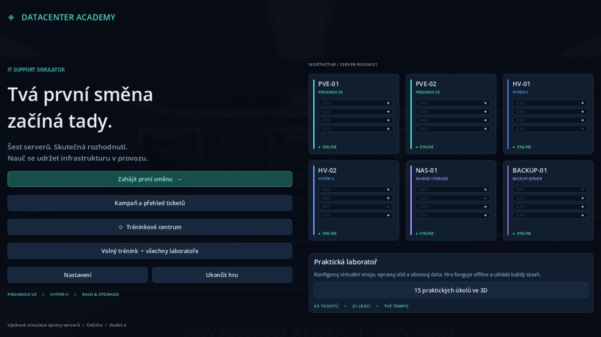
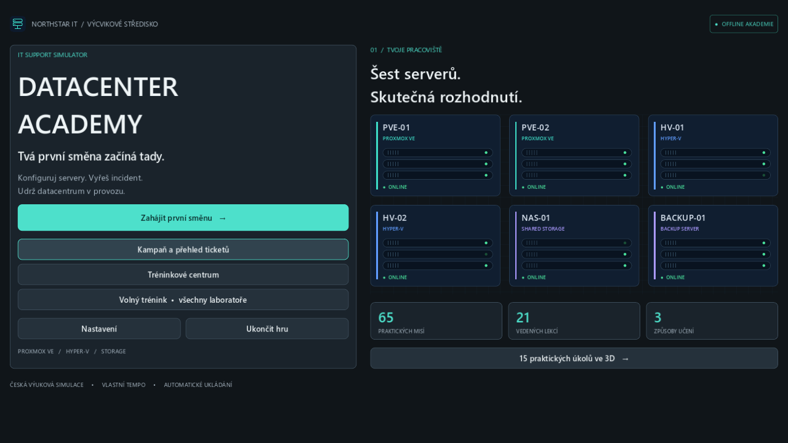
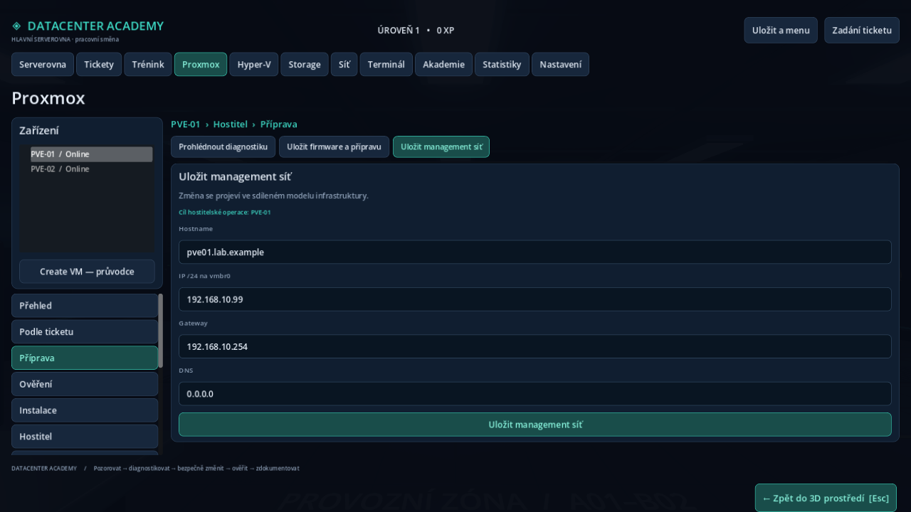
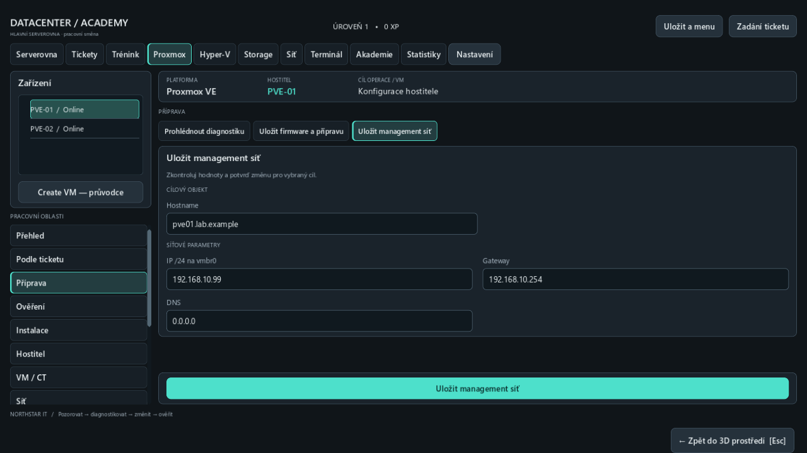
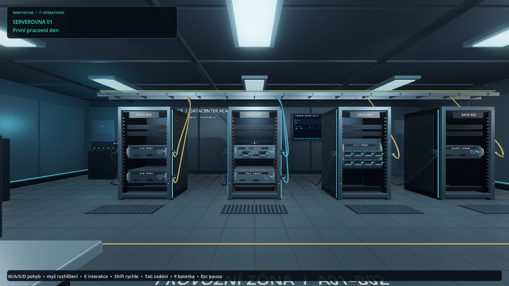
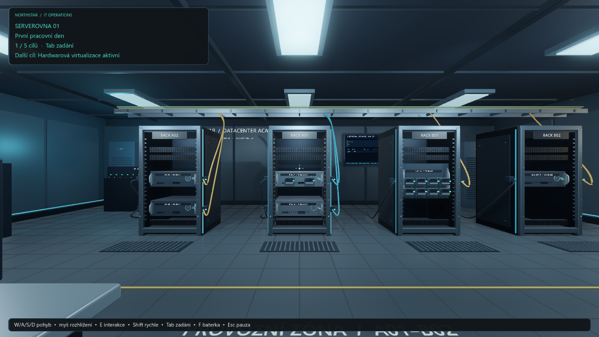
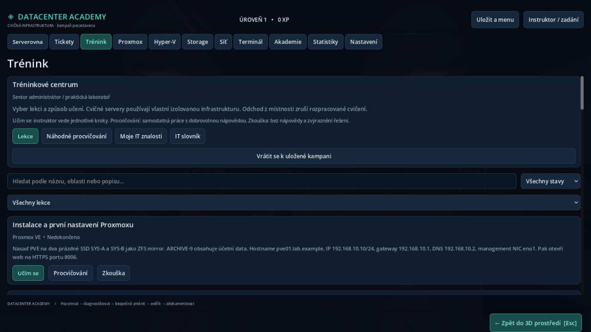
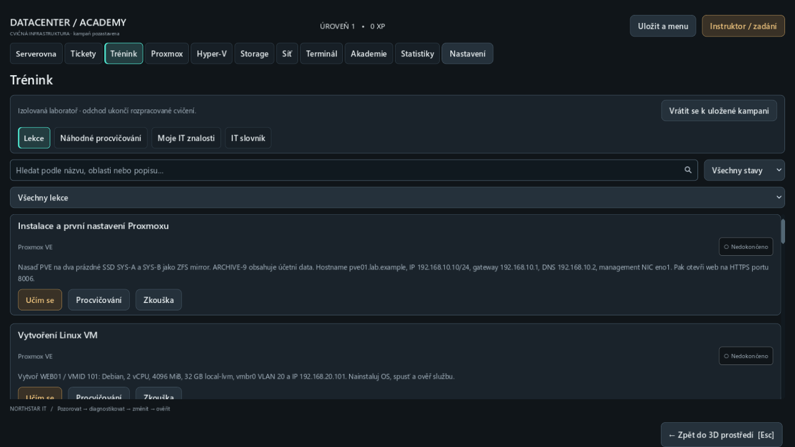
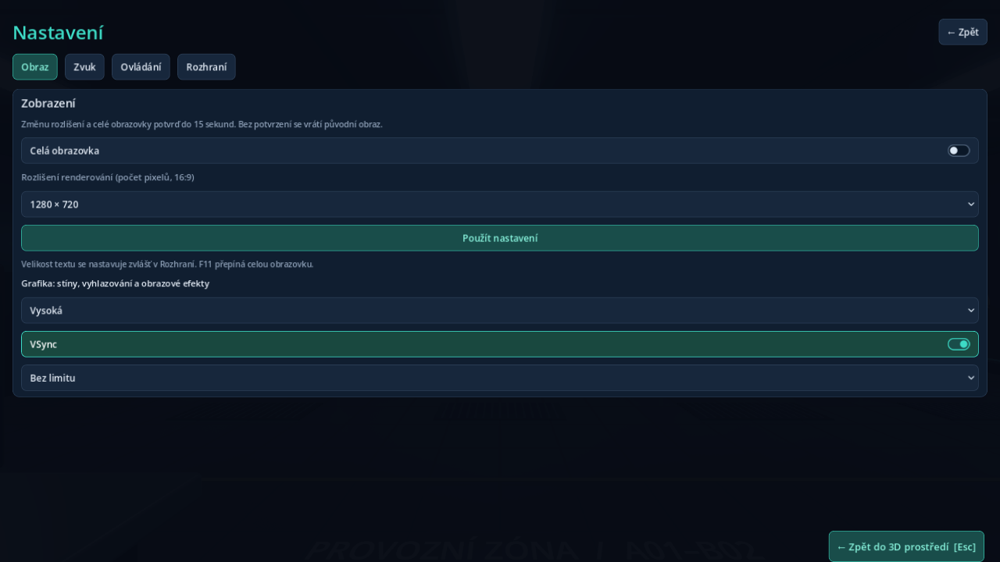
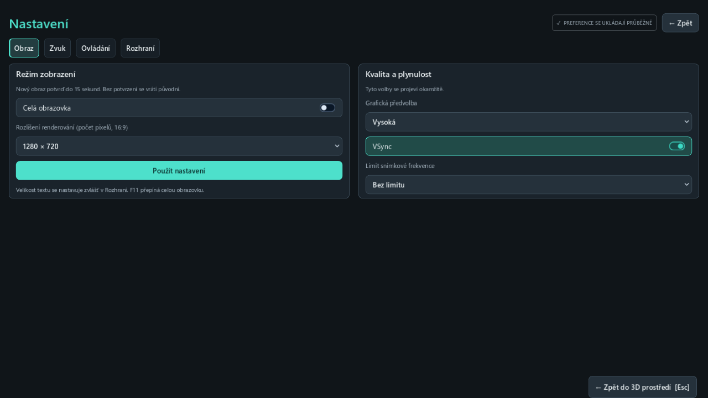

# Vizuální úprava rozhraní — 25. 10. 2026

Hra zůstává 3D simulátorem. Hlavní scéna, serverovna, pohyb, fyzické
interakce i sousední akademie používají původní herní systémy.

## Zjištěné problémy a změny

| Při prohlídce spuštěné hry | Výsledná úprava |
|---|---|
| Výběr navigace a potvrzení vypadaly stejně | Samostatný stav výběru a výrazná tyrkysová hlavní akce |
| Šedý výchozí strom, drobné popisky | Sdílené téma, čitelnější písmo a stavové zvýraznění stromu |
| Kontext hostitele a VM se snadno ztratil | Trvalé záhlaví platformy, hostitele a skutečného cíle formuláře |
| Dlouhá řada polí přes celou šířku | Logické skupiny a sloupce; potvrzení zůstává pod posuvným obsahem |
| Formátová chyba byla oddělená od vstupu | Zpráva i rámeček u pole, automatický fokus, oprava bez překreslení |
| Úvod výuky zabral téměř polovinu obsahu | Kratší úvod, pevné filtry, čitelné stavy a kompaktnější lekce |
| HUD měl pouze název mise | Skutečný další nesplněný cíl, počet dokončených cílů a klávesa zadání |

## Srovnatelné snímky

Všechny níže uvedené PNG jsou původní framebuffer 1280×720, text 100 %,
Forward+/Vulkan na RTX 5060. Před i po byla spuštěná hlavní 3D scéna přes
Godot MCP, s novým izolovaným save a nastavením. Konzole ukazuje stejné
počáteční hodnoty první mise; snímek 3D používá stejný výchozí pohled.

| Obrazovka | Před | Po |
|---|---|---|
| Menu |  |  |
| Konzole |  |  |
| 3D / HUD |  |  |
| Lekce |  |  |
| Nastavení |  |  |

## Grafické ověření

- Celý `tools/Test-All.ps1`: 23 sad PASS, exit 0, bez runtime chyb/varování;
  všech 65 misí, 21 lekcí ve třech režimech, save a oddělení kampaně.
- `ui_design.gd`: 162 kontrol headless i GPU, všech 6 kombinací 720p/1080p/4K
  × 100/130 % textu. Navigace a akce se ovládají událostmi myši, oprava pole
  skutečnou klávesou. Ověřuje místní chybu, fokus, kurzor hledání i cílovou VM.
- `DesignMCP.tscn`: 31 kontrol nad skutečnou 3D scénou ve stejné matici.
  Snímky kampaně, konzole, nastavení, lekcí a instruktora byly prohlédnuté.
- GPU regrese: `console_ux` 60, `tutorial_navigation` 700, `world_ui` 27,
  `display_settings` 76 a `render_quality` 8 kontrol PASS.
- Ve 4K měly SVG ikony skutečnou texturu 38×38 px a písmo ostřejší hrany
  než zvětšený původní atlas. Oversampling i DPITexture jsou zachované.
- Godot MCP: 79 interaktivních objektů; raycast/E, otevření managementu,
  změna a save, návrat do 3D, opakované otevření/zavření dveří a vedená
  výuka přes skutečné klikání PASS, `errors=[]`.
- Aktualizovaný Windows EXE+PCK: skutečný grafický běh 162 UI a 27 kontrol
  3D hry PASS, oba exit 0 a čistý stderr.

Podrobné screenshoty všech rozlišení jsou v ignorovaném `test-output/`
(`design-final-*`, `design-world-*`); logy mají prefix `design-`.
Headless a grafický běh nové sady mají rozdílné testovací save/config cesty.
Mise, lekce, generátory a `legacy_campaign.json` se neměnily.

Při 130 % se dlouhý formulář i menu posouvají; potvrzení konzole zůstává
viditelné. Výběr disků může vyžadovat posuv, stejně jako delší seznamy.
Písmo používá Segoe UI s fallbacky Noto Sans / DejaVu Sans.
